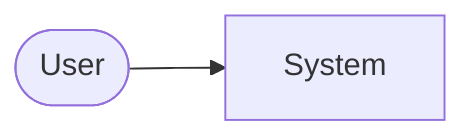

# Architecture: <name>

- **Status**: draft | approved (YYYY-MM-DD)
- **Spec**: [spec.md](spec.md)

## 1. Overview
<!-- One paragraph + a context diagram (Mermaid) of the system and its external actors. -->



## 2. Technology stack
| Concern | Choice | Version | Why (ADR) |
|---|---|---|---|
| Language | | | |
| Framework | | | |
| Data store | | | |
| Testing | | | |
| Lint / format | | | |
| Packaging / deploy | | | |

## 3. Components
<!-- For each component: responsibility, public interface, dependencies, owning directory. -->

## 4. Data model
<!-- Entities, schema sketch, migrations strategy. -->

## 5. Key flows
<!-- Sequence diagrams for the critical user journeys. -->

## 6. Interfaces
<!-- API contracts, CLI grammar, events, file formats. Link to OpenAPI/JSON schema if present. -->

## 7. Cross-cutting concerns
- **Configuration & secrets**:
- **Error handling**:
- **Logging / observability**:
- **Security** (authn/z, input validation, data protection):
- **Performance**:
- **Accessibility / i18n**:

## 8. Repository layout
```
<tree of top-level directories and their purpose>
```

## 9. Testing strategy
<!-- Unit / integration / e2e split, tools, what is mocked, coverage target, how NFRs are tested. -->

## 10. Deployment and release
<!-- Environments, CI/CD pipeline, artifact type, target registry/host. -->

## 11. Risks
| Risk | Likelihood | Impact | Mitigation |
|---|---|---|---|

## 12. Requirement coverage
| Requirement | Component(s) |
|---|---|
