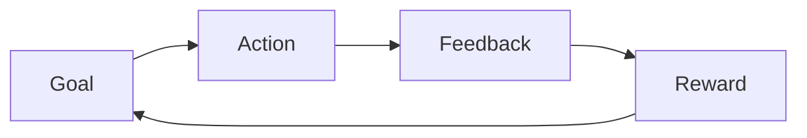

# Game Design: <name>

- **Status**: draft | approved (YYYY-MM-DD)
- **Spec**: [spec.md](spec.md) · **Design**: [design.md](design.md)

## 1. Pitch and pillars
<!-- One-sentence pitch. Three pillars every decision is checked against. -->

## 2. Core loop

<!-- Second-to-second, minute-to-minute, session-to-session loops. -->

## 3. Mechanics and rules
<!-- Each mechanic: rules, numbers, states, edge cases. Precise enough to test. -->

## 4. Controls and game feel
| Action | Keyboard/mouse | Gamepad | Touch | Feedback (visual / audio / haptic) |
|---|---|---|---|---|
<!-- Responsiveness targets: input latency, buffering, coyote time, hit-stop, and so on. Remapping. -->

## 5. Progression, economy and difficulty
<!-- Currencies, sources/sinks, unlock curve, difficulty curve (chart or table). -->

### Tuning values (loaded from data files)
| Key | Value | Unit | File | Notes |
|---|---|---|---|---|

## 6. Content
<!-- Levels/encounters/items for the MVP, content pipeline and data format. -->

## 7. Onboarding
<!-- How each mechanic is taught (teach → test → twist). -->

## 8. Accessibility
<!-- Difficulty options, remapping, colour-blind-safe signals, subtitles, reduced flashing, pause anywhere. -->

## 9. Monetization
<!-- Model, or "none". Ethical limits. -->

## 10. Balance evidence
<!-- Simulation and playtest-bot results: date, build, key numbers. -->

## 11. Human playtest questions
<!-- What only a person can judge; results of the user's playtests. -->

## 12. Later
<!-- Deferred ideas. -->
