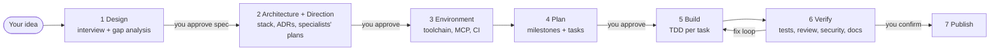

# Claude Agents Template

A GitHub template repository with a **full software team of Claude Code agents**. You give it an idea. The team interviews you until the requirements are clear, then designs the system, sets up the environment (toolchain, MCP servers, CI), plans the work, builds it test-first, verifies it, and publishes it. It stops for your approval at each important decision.

## Quick start

1. Click **Use this template** on GitHub (or copy this repo), then clone your new repository.
2. Open it in Claude Code (CLI, desktop, IDE, or claude.ai/code).
3. Approve the project MCP servers (`context7`, `playwright`) when prompted. They need Node.js (`npx`).
4. Run:

```
/kickoff "A CLI that turns my markdown notes into a searchable static site, published to GitHub Pages"
```

Add `--autonomous` if you want the team to stop only at the Design, Architecture, and Publish gates.

You can stop at any time. All state is kept in `docs/project/`, so a new session resumes where the last one stopped. Run `/kickoff` again, or `/project-status`.

## How it works



Each build task goes to its owner (**developer** or a specialist) → **test-engineer** + **code-reviewer** (in parallel) → fix loop → commit. At the end of each milestone, the **security-auditor**, **docs-writer** and every specialist on the project review the work, and you get a demo.

### The team

The **core team** works on every project. **Specialists** join when the spec calls for them (for example, `mobile-developer` only for iOS/Android targets). The kickoff proposes the list and you can change it. See `CLAUDE.md` → "When each specialist joins".

| Agent | Model | Does |
|---|---|---|
| **Core** | | |
| `requirements-analyst` | opus | Finds gaps in the spec and proposes the next interview questions |
| `architect` | opus | Stack selection, system design, ADRs |
| `environment-engineer` | sonnet | Scaffold, toolchain, lint/test tooling, MCP servers, dev container, CI |
| `planner` | opus | Milestones and small, traceable tasks, each with an owner |
| `developer` | sonnet | Implements one task with TDD and commits |
| `test-engineer` | sonnet | Acceptance verification, integration/e2e tests, coverage, bug reproduction |
| `code-reviewer` | opus | Read-only correctness and design review |
| `security-auditor` | opus | Threat model, OWASP review, dependency and secret audit |
| `docs-writer` | sonnet | README, guides, API docs, CHANGELOG |
| `release-engineer` | sonnet | Versioning, artifacts, release CI, publishing |
| **Specialists** | | |
| `visual-designer` | opus | UX, design system, accessibility, icons/SVG, graphics code, image assets, visual review |
| `audio-designer` | sonnet | Audio direction, synthesized/sourced/generated sound, audio pipeline, loudness QA |
| `game-designer` | opus | Core loop, mechanics, controls and feel, progression and balance, simulations, playtest bots |
| `data-engineer` | opus | Data model, migrations, pipelines, search/analytics, ML models, LLM features and evals |
| `mobile-developer` | sonnet | iOS/Android/cross-platform apps, device testing, store readiness |
| `sre` | sonnet | Hosting, infrastructure as code, deploys, observability, SLOs, backups, runbooks, cost |
| `performance-engineer` | sonnet | Budgets, benchmarks, load tests, profiling, optimisation, CI perf gates |

### Commands (skills)

| Command | Purpose |
|---|---|
| `/kickoff "<idea>" [--autonomous]` | Run or resume the full pipeline |
| `/design-session [revise]` | The design interview, producing `spec.md` |
| `/env-setup [change]` | Set up or change the environment and MCP servers |
| `/plan-project [revise …]` | Create or revise `plan.md` |
| `/build-next [T-n \| milestone \| M<n>]` | Implement, verify, review, and commit tasks |
| `/test-suite [T-n \| M<n> \| full \| bug: …]` | Test and strengthen the tests. Reproduce bugs |
| `/review-changes [scope] [--fix]` | Code review + security audit in parallel |
| `/publish [version]` | Prepare and publish a release (always asks first) |
| `/project-status` | Where things stand, and the next step |

## What is in the repo

```
CLAUDE.md                     Team rules and workflow. Claude reads this every session
.mcp.json                     Project MCP servers (the environment-engineer extends it)
.claude/
  agents/                     The 17 agent definitions (10 core + 7 specialists)
  skills/                     The workflow commands above
  templates/                  Spec, architecture, ADR, plan, status, environment, release checklist, MCP catalog,
                              and specialist docs: design, assets, game-design, data-ml, operations, performance
  hooks/session-start.sh      Shows project status at session start. Runs scripts/setup.sh in cloud sessions
  hooks/guard-bash.sh         Blocks force-push to main, rm -rf /, and publish/deploy without approval
  settings.json               Permissions and hook wiring
docs/project/                 Project artifacts (filled in by the team)
.github/pull_request_template.md
```

## Safety rails

- **Approval gates** for the spec, architecture, plan, new credentialed MCP servers, and publishing. The publish gate always applies, even in autonomous mode.
- **Guard hook**: publish, deploy, and tag-push commands (`npm publish`, `twine upload`, `cargo publish`, `docker push`, `gh release create`, `git push --tags`, and others) are blocked unless `.claude/.publish-approved` exists. The `/publish` skill creates that file only after you confirm, and deletes it afterwards. The hook matches command text, so it can also block a harmless command that only mentions one of these words (for example, in a heredoc). Write such content with a file tool instead.
- **Secrets** stay out of git. `.env*` is gitignored, `Read` of `.env` files is denied, and MCP configs use `${VAR}` expansion. The team asks you to set secrets as environment variables. It never asks you to paste them into the chat.
- **Read-only reviewers**: `code-reviewer` and `security-auditor` have no file-edit tools.

## Graphics and sound

The design session asks about visual style, graphics, audio, and where assets come from. The designers then produce the design direction with the architect.

- **Made directly by the team**: UI and design systems, SVG icons and illustrations, Canvas/WebGL/shader graphics, and synthesized audio (Web Audio, sox/ffmpeg).
- **Needs a source**: raster art, sprites, photos, music, voice. Options: free-licensed libraries (Kenney, Poly Haven and others, with licenses checked per file), AI generation through an MCP server (paid, needs an API key, and your approval), or your own files. Placeholders keep the build moving until the real assets arrive.
- **Checked**: screenshot-based visual review and regression tests, measured audio (format, loudness, clipping, loops), and license checks of every asset in `docs/project/assets.md` before release.
- **Limits**: the agents cannot hear, and their taste needs your eye. Each milestone demo lists the sounds and visuals you should check yourself.

## Specialist notes

- **Mobile**: iOS apps can only be built on macOS. In a Linux or cloud session, the team builds and tests Android and cross-platform code locally, and sets up macOS CI (or EAS Build) for iOS. Store submission is treated as publishing and needs your confirmation.
- **Hosted services**: the `sre` proposes hosting with a monthly cost estimate, practises staging deploys from the first milestone, and runs a readiness review (rollback, alerts, backups) before production. Creating paid resources or deploying always needs your confirmation.
- **AI features**: the `data-engineer` builds an evaluation set and pass thresholds for every LLM or ML feature, and reports the cost per request.
- **Games**: the `game-designer` keeps all tuning values in data files and backs balance with simulations and playtest bots. Each milestone demo tells you which parts to play and what to judge.
- **Performance**: budgets come from your NFRs and are checked with real measurements. Numbers from a cloud container are not your production numbers, and the reports say so.

## Claude Code on the web

In a cloud session, the SessionStart hook runs `scripts/setup.sh` (which the environment-engineer creates), so dependencies are installed automatically. Set any required secrets as environment variables in the cloud environment's settings, and allow the network hosts your stack needs (package registries and so on).

## Customizing

- **Models**: change `model:` in any `.claude/agents/*.md` (`opus`, `sonnet`, `haiku`, or `inherit`).
- **Add a specialist**: add a new agent file (for example `ux-designer.md`, `data-engineer.md`, `mobile-developer.md`), then reference it in `CLAUDE.md` and in the skill where it should run.
- **Gates**: edit the gate lines in `.claude/skills/kickoff/SKILL.md`, or set the default autonomy in `.claude/templates/status.md`.
- **Default MCP servers**: edit `.mcp.json`. See `.claude/templates/mcp-catalog.md` for common servers and selection rules.
- **Permissions**: the environment-engineer adds your stack's build/test commands to `.claude/settings.json`. Put personal overrides in `.claude/settings.local.json` (gitignored).

## Design notes

- Subagents in Claude Code cannot talk to the user or start other subagents. So the **main conversation orchestrates**: the skills tell it when to interview you, which agents to launch (in parallel where possible), and what to verify itself.
- Every artifact is a markdown file in `docs/project/` with stable IDs (`FR-n`, `NFR-n`, `T-n`, ADR numbers). This gives traceability from requirement to task, test, and commit, and lets any session resume the work.
- When the first milestone ships, the docs-writer replaces this README with the project's own README and moves these instructions to `docs/agent-team.md`.
