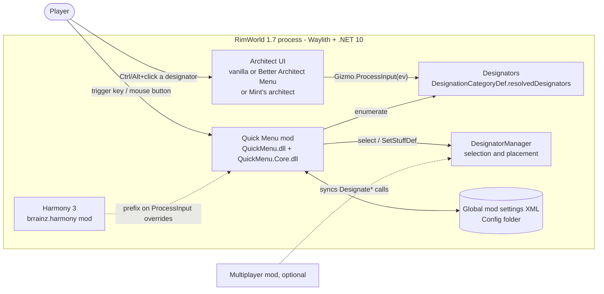
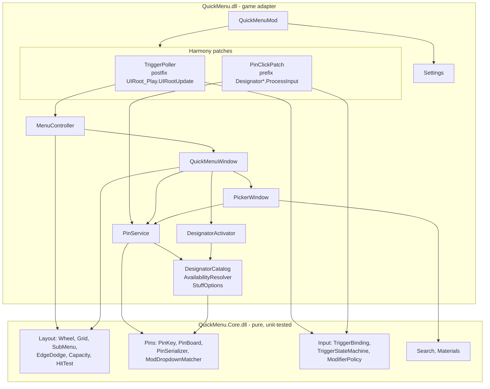
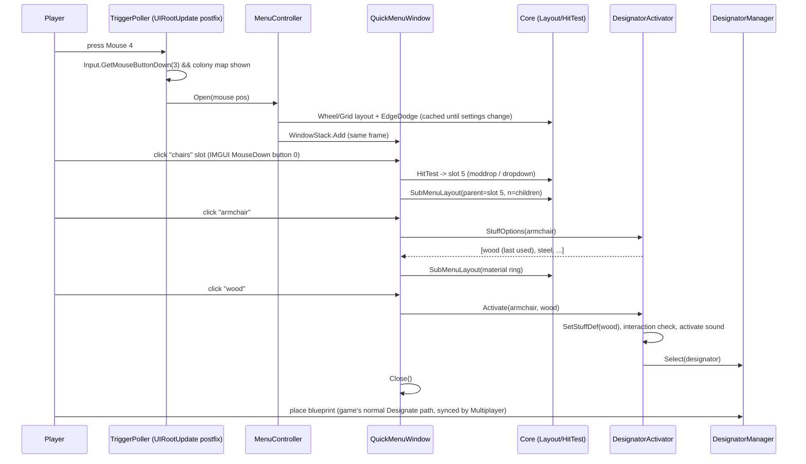
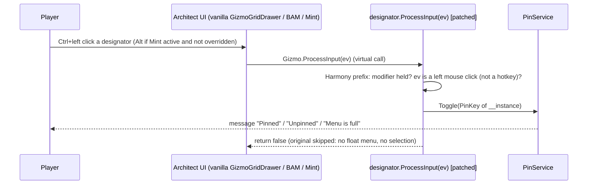

# Architecture: rimworld-quick-menu

- **Status**: approved (2026-10-19)
- **Spec**: [spec.md](spec.md) · **ADRs**: [decisions/](decisions/) · **Design**: [design.md](design.md) · **Performance**: [performance.md](performance.md)

## 1. Overview

Quick Menu is a RimWorld 1.7 C# mod. It shows a radial wheel or a grid of pinned architect designators around the mouse. It has no server, no network and no save-game data. Everything runs inside the game process. The mod is a single shipped folder with two assemblies:

- **QuickMenu.Core**: pure, engine-free logic (layout maths, edge dodging, sizing, pin identity and storage, trigger state machine, search). It is unit-tested outside the game (NFR-8).
- **QuickMenu**: a thin adapter between the game and Core. It holds the Harmony patches, input polling, designator catalog and activation, IMGUI drawing, and mod settings.

**RimWorld 1.7 is a new platform.** The installed game is `1.7.4982 rev1280`. It runs on Ludeon's **Waylith** engine and a patched **CoreCLR, .NET 10** (`RimWorld.runtimeconfig.json`: `tfm net10.0`, framework `10.0.13-waylithclr.dev`). Unity and Mono are gone. Unity APIs are provided by `UnityStubs.dll`, and `UnityEngine*` references are redirected to it. Mods target `net10.0` and reference `Assembly-CSharp.dll`, `UnityStubs.dll` and `Waylith.dll`. Harmony is **Harmony 3** (workshop `brrainz.harmony` ships `0Harmony 3.0.0-rc.3` built for .NETCoreApp 10.0). See [ADR 0001](decisions/0001-target-rimworld-1-7-waylith-net10.md).



## 2. Technology stack

| Concern | Choice | Version | Why (ADR) |
|---|---|---|---|
| Language | C# | 14 (default for net10.0) | Required by RimWorld mods ([0001](decisions/0001-target-rimworld-1-7-waylith-net10.md)) |
| Runtime / target framework | .NET 10 (`net10.0`), SDK-style csproj | .NET SDK 10.0.1xx (newest seen: 10.0.112; Fedora `dotnet-sdk-10.0`) | 1.7 runs on CoreCLR net10 ([0001](decisions/0001-target-rimworld-1-7-waylith-net10.md)) |
| Game API | RimWorld `Assembly-CSharp`, `UnityStubs`, `Waylith` (compile-time refs via **Krafs.Rimworld.Ref**) | `1.7.4982-unstable` (matches the installed build) | CI can compile without game files. Fallback: local game DLLs via `RIMWORLD_DIR` ([0001](decisions/0001-target-rimworld-1-7-waylith-net10.md)) |
| Patching | Harmony 3 (`Lib.Harmony`, compile-only, `ExcludeAssets=runtime`) | `3.0.0-rc.3` | Required by 1.7. The runtime copy comes from the `brrainz.harmony` mod (NFR-3) ([0001](decisions/0001-target-rimworld-1-7-waylith-net10.md), [0005](decisions/0005-pin-by-click-processinput-prefix.md)) |
| UI | RimWorld IMGUI (`Verse.Window`, `Widgets`, `GUI` through UnityStubs) | game | The only supported mod UI path. Ludeon advises against migrating Imgui to native Waylith ([0007](decisions/0007-menu-host-fullscreen-imgui-window.md)) |
| Data store | `Verse.ModSettings` (global XML in the game's Config folder) | game | FR-17: global, nothing in saves ([0004](decisions/0004-pin-identity-and-storage.md)) |
| Testing | xUnit.net v3 on Microsoft Testing Platform + `Microsoft.Testing.Extensions.CodeCoverage` | `xunit.v3` 4.0.x (4.0.2 latest stable) | Pure Core is tested outside the game ([0002](decisions/0002-core-library-split-and-xunit.md)) |
| Benchmarks | BenchmarkDotNet | latest stable, pinned by the environment-engineer | Allocation and timing numbers for performance.md budgets ([0008](decisions/0008-repo-layout-and-packaging.md)) |
| Lint / format | `.editorconfig` + `dotnet format`, Roslyn analyzers (`AnalysisLevel=latest-recommended`), nullable on in Core | SDK built-in | No extra dependencies |
| Packaging / deploy | `mod/` folder (About, LoadFolders, `1.7/Assemblies`, Languages, Textures) zipped; Steam Workshop upload by the user from the game; GitHub release zip | — | [0008](decisions/0008-repo-layout-and-packaging.md) |
| CI | GitHub Actions, `ubuntu-latest`, `actions/setup-dotnet` (10.0.x) | — | Builds both assemblies with reference packages and runs Core tests |

## 3. Components

Directory paths are relative to the repo root. "Core" components have no reference to any game or Unity assembly.

### Core (`src/QuickMenu.Core/`, pure, unit-tested)

The exact geometry (constants, ring capacity table, fill order, hub, buttons, label plate, bounding boxes, hit shapes, sub-menu and material placement, edge dodging, and worked defaults for tests) is specified in [design.md §1.1](design.md). Core implements it exactly and tests it against those numbers.

| Component | Responsibility | Public interface (sketch) |
|---|---|---|
| **Geometry** | Value types used everywhere | `Vec2`, `Rect2` (float, UI units) |
| **Layout.Wheel** | Slot centres for N rings around a centre: ring radii from button size and gap, slots per ring growing with circumference. The centre is the **hub**, a non-slot hit region with two sub-targets: **Close** (main area) and **Edit** (small target, shows **Done** in edit mode). See HitTest | `WheelLayout.Compute(WheelParams) -> SlotPlacement[]` |
| **Layout.Grid** | Rows/columns of slots around a centre, odd counts so the centre cell sits under the mouse. The centre cell is the **hub** (same as the wheel: Close main area plus a small Edit/Done target; exact geometry in design.md §1.1 and S4a), never a slot | `GridLayout.Compute(GridParams) -> SlotPlacement[]` |
| **Layout.SubMenu** | Places a sub-ring (wheel) or sub-grid (grid) beside a parent slot, for dropdowns (FR-11) and materials (FR-12) | `SubMenuLayout.Compute(parent, count, kind, screen)` |
| **Layout.EdgeDodge** | Minimum shift so the bounding box fits on screen; centre on screen if too big (FR-3) | `EdgeDodger.Fit(Rect2 bounds, Vec2 screen) -> Vec2 offset` |
| **Layout.Capacity** | Fixed capacity from settings; Auto growth (next ring/row) until the next step would not fit on screen, then full (FR-5, FR-6) | `Capacity.Fixed(settings)`, `Capacity.AutoShape(count, screen)` |
| **Layout.HitTest** | Point to a typed hit: `Slot(i)`, `HubClose`, `HubEdit`, `Button(kind)`, `Plate`, `Outside`. The Edit sub-target is tested before HubClose; buttons before slots. The hub is never returned as a slot. Sub-target geometry comes from design.md §1.1 | `HitTester.Hit(Vec2, layout) -> Hit` |
| **Pins.PinKey** | Stable identity string, parse and format ([0004](decisions/0004-pin-identity-and-storage.md)) | `PinKey.Build(thing/terrain, defName)`, `.Dropdown(defName)`, `.Order(type, ordinal)`, `.ModDropdown(type, category, children)`, `TryParse` |
| **Pins.PinBoard** | Pin list with Fixed/Auto semantics: toggle (FR-15), swap, clear, insert cursor (FR-9), full detection (FR-5), reserved slots for unresolved pins (FR-14), forget missing pins, mode conversion | `Toggle(key) -> PinResult {Pinned, Unpinned, Full}`, `Swap(a,b)`, `Clear(i)`, `SetCursor(i)`, `VisibleSlots(resolver)`, `ForgetUnresolved(resolver) -> int removed`, `CountUnresolved(resolver)` |
| **Pins.PinSerializer** | Versioned one-line-per-pin text records; unknown or unresolvable keys kept verbatim | `ToLines(board)`, `FromLines(lines)` |
| **Pins.ModDropdownMatcher** | Best match for a non-def dropdown by type, category and child-key overlap | `Match(stored, candidates) -> index or none` |
| **Input.TriggerBinding** | `None`, `Key(keyCode)`, `Mouse(index 2..4)`; label; serialise | value type |
| **Input.TriggerStateMachine** | Toggle and hold behaviour (FR-2): trigger press and release, Esc, click or release on a `Hit`, map lost. It produces `Open`, `Close`, `Back`, `Activate(slot)`, `OpenSub(slot)`, `EnterEdit` and `ExitEdit`. Hub rules: a **click on HubClose closes**; a **hold-mode release over the hub (either sub-target) cancels**, which means Close, or Back when a satellite is open; **HubEdit reacts only to a deliberate click** (MouseDown and MouseUp both on it, in either mode) and never to a hold release; in edit mode HubEdit is **Done** (ExitEdit, settings written once). Clicking the satellite's own hub = Back (design.md §1.2 S3) | `Handle(TriggerEvent) -> MenuCommand` |
| **Input.ModifierPolicy** | Effective pin modifier: user choice, or Alt when Mint is active and the user has not chosen (FR-8). The adapter computes it once at startup and again when settings change, then caches it. The click prefix reads the cached value and never calls `ModsConfig` | `Effective(settings, mintActive)` |
| **Render.MaskRasterizer** | Generates anti-aliased grayscale masks as byte arrays: disc, ring of a given stroke, rounded rect, small glyphs for badges. Deterministic and unit-tested (pixel coverage at edges, sizes). The adapter turns them into textures ([0007](decisions/0007-menu-host-fullscreen-imgui-window.md)) | `MaskRasterizer.Disc(size)`, `.Ring(size, stroke)`, `.RoundedRect(w, h, radius)` → `byte[]` |
| **Search.SearchIndex** | Case-insensitive token match on label, category and mod name (FR-7). Entries are a plain Core record `SearchEntry { int Id; string Label; string Category; string ModName; bool DevOnly; int ParentId }`. It holds no game types. `Id` indexes the adapter's designator table. Allocation-free queries into a caller-owned result list | `Build(IReadOnlyList<SearchEntry>)`, `Query(text, List<int> results)` |
| **Materials.StuffOrdering** | Order materials last-used first; skip the ring when there is one; "none" state (FR-12) | `Order(options, lastUsed)` |

### Game adapter (`src/QuickMenu/`, thin, tested in-game)

| Component | Responsibility | Depends on |
|---|---|---|
| **QuickMenuMod** (`Verse.Mod`) | Entry point: loads settings, applies Harmony patches, detects Mint/BAM/MP, settings window | Harmony, Settings, Compat |
| **Settings** (`QuickMenuSettings : ModSettings`) | `ExposeData` for all settings and pin lines; settings UI: trigger binding control, mode, layout, sizing, sizes, modifier, "use middle mouse" button | Core.Input, Core.Pins |
| **Settings.BindingCaptureWindow** | Custom "press a key or mouse button" dialog: keys from IMGUI `KeyDown` events; mouse buttons by polling `Input.GetMouseButtonDown(2..4)` in `WindowUpdate`; Esc cancels; left/right buttons rejected; warns on conflicts with game key bindings ([0003](decisions/0003-custom-trigger-binding-and-input-polling.md)) | UnityStubs `Input`, `KeyPrefs` |
| **Input.TriggerPoller** | Harmony postfix on `RimWorld.UIRoot_Play.UIRootUpdate` (runs once per frame). Polls only the bound key or button. Opens or toggles the menu when a colony map is shown | Core.Input, MenuController |
| **Compat.ModDetection** | `ModsConfig.IsActive("Dubwise.DubsMintMenus")`, BAM (`ferny.BetterArchitect`), Multiplayer; one-time Mint notice | — |
| **Catalog.DesignatorCatalog** | Lists every architect designator independently of the architect UI: all `DesignationCategoryDef`s, `AllResolvedAndIdeoDesignators`, dropdown children flattened for search. Builds `PinKey` for each designator and resolves `PinKey` to a live designator (FR-7, FR-10). **Static part is built once at startup** (`[StaticConstructorOnStartup]`, on the loading screen, after defs are resolved): designator table, key map, `SearchEntry[]` and `SearchIndex`. **Ideology part** is refreshed only when its change signature differs: (current `Game` instance, player's primary `Ideo`, ideo precept count). It is checked on open in O(1) ([0006](decisions/0006-designator-catalog-and-activation.md)) | Core.Pins, Core.Search |
| **Catalog.AvailabilityResolver** | Visible/disabled state and reason text: `Gizmo.Disabled` + `disabledReason`; for `Visible == false` composes a reason from the known causes (research, tech level, building/discovery prerequisites, monolith, grav engine), else a generic keyed string (FR-14) | Keyed strings |
| **Catalog.StuffOptions** | Materials the architect would offer: map resource-counter stuffs that `CanMake` the def and exist on the map (or god mode), as vanilla `Designator_Build.ProcessInput` does (FR-12) | Core.Materials |
| **Activation.DesignatorActivator** | Activates a slot exactly like the architect (FR-13): plain designators get `designator.ProcessInput(Event.current)`; stuff builds get `SetStuffDef(stuff)` then the base select path (interaction check, activate sound, `DesignatorManager.Select`); dropdown elements get the same treatment as a direct element ([0006](decisions/0006-designator-catalog-and-activation.md)) | Catalog |
| **Pinning.PinClickPatch** | Harmony prefix on every declared `ProcessInput(Event)` override in the `Designator` hierarchy (all loaded assemblies). If the effective modifier is held and the event is a left mouse click, it toggles the pin, shows a message, and skips the original (FR-8, FR-15) ([0005](decisions/0005-pin-by-click-processinput-prefix.md)) | Harmony, PinService |
| **Pinning.PinService** | Owns the runtime `PinBoard`, resolves keys through the catalog key map (built at startup, so opening the menu does no catalog work), sends player messages (pinned, unpinned, full). **Settings writes**: once per pin-by-click or picker pin, and in edit mode once when edit mode ends or the menu closes (dirty flag). Never per drag step and never per frame | Core.Pins, Catalog, Settings |
| **UI.MenuController** | Opens and closes `QuickMenuWindow`, computes layout once per open or settings change, routes Core state machine commands | Core.Layout, Core.Input |
| **UI.QuickMenuWindow** (`Verse.Window`) | Full-screen, transparent, non-pausing window. Draws the wheel or grid, sub-rings and the material ring; hit tests via Core; edit mode (drag swap, right-click clear, insert cursor); hold-mode release polling in `WindowUpdate`; closes on Esc, outside click, selection, or map change ([0007](decisions/0007-menu-host-fullscreen-imgui-window.md)) | Core, Activation, PinService |
| **UI.PickerWindow** | Searchable list of the catalog; greyed locked items; dev-only items only in dev mode; click to pin (FR-7) | Catalog, Core.Search |
| **UI.Textures / Sounds** | `[StaticConstructorOnStartup]` texture cache. Masks are generated at runtime from Core's `MaskRasterizer` into `Texture2D` at the current button size and UI scale. The fallback is shipped PNG masks in `mod/Textures/QuickMenu/UI/` via `ContentFinder<Texture2D>`, and the last resort is the game's asset baker (spike S-7). Vanilla `SoundDefOf` sounds only | — |
| **Diagnostics.SelfTest** | Dev-mode debug action: enumerate the catalog, round-trip every designator through `PinKey`, report duplicates, unresolved keys, patch count and index build time. This is the in-game integration test | Catalog, PinClickPatch |
| **Diagnostics.Log** | `LogOnce(key, message)`: errors logged once per key (NFR-6) | `Verse.Log` |



## 4. Data model

Nothing is written to save files (FR-17). There are no GameComponents, WorldComponents, MapComponents or defs that a save would reference. All state lives in one `ModSettings` file in the game's Config folder (`Mod_sixdd.QuickMenu_QuickMenuSettings.xml`).

| Field | Type | Default | Notes |
|---|---|---|---|
| `schemaVersion` | int | 1 | Migration switch in `ExposeData` |
| `trigger` | `TriggerBinding` (kind + code) | Mouse index 3 ("Mouse 4") | `None` = unbound (FR-1) |
| `triggerMode` | Toggle / Hold | Toggle | FR-2 |
| `layout` | Wheel / Grid | Wheel | FR-4 |
| `sizing` | Fixed / Auto | Fixed | FR-5 |
| `rings` | int 1–5 (Fixed) | 2 | FR-6. Auto grows up to 8 rings (design.md §1.1) |
| `gridColumns` | int, odd: 3, 5, 7, 9, 11 | 5 | FR-6 |
| `gridRows` | int, odd: 1, 3, 5, 7 (Fixed) | 3 | FR-6. Auto grows up to 9 rows |
| `buttonSize` | float (UI units) 36–96, step 4 | 56 | FR-6, NFR-5 |
| `pinModifier` | Ctrl / Alt / Shift | Ctrl | FR-8 |
| `pinModifierUserSet` | bool | false | When false and Mint is active, Alt is used |
| `firstRunNoticeShown`, `mintNoticeShown` | bool | false | One-time messages |
| `pins` | `List<string>` (pin lines) | empty | Read and written by `PinSerializer` |

**Pin line (v1)**: `slot|key|packageId|label`. `|` and `\` are escaped with `\`.
- `slot`: slot index (Fixed) or order (Auto).
- `key`: `PinKey` (below).
- `packageId`: owning mod, so a missing pin can be shown as "from <mod>" in edit mode.
- `label`: last known label, for tooltips of unresolved pins.

**PinKey grammar** ([ADR 0004](decisions/0004-pin-identity-and-storage.md), resolves Q-1):

```
key        := build | dropdown | order | moddrop
build      := "build:" ("thing" | "terrain") "/" defName            ; Designator_Build over ThingDef / TerrainDef
dropdown   := "dropdown:" designatorDropdownGroupDefName            ; Designator_Dropdown whose elements all share one DesignatorDropdownGroupDef
order      := "order:" typeFullName [ "#" ordinal ]                  ; any other Designator; ordinal only if a type appears more than once
moddrop    := "moddrop:" typeFullName "@" categoryDefName "~" child ("," child)*   ; non-def dropdown, children = sorted child keys
```

- **Resolution order**: exact key → for `build:` keys, `BuildCopyCommandUtility.FindAllowedDesignator(def)` (it finds builds inside dropdowns and in other categories, for example after BAM regroups them) → for `moddrop:`, `ModDropdownMatcher` (same type, best child overlap ≥ 0.5, same category breaks ties) → unresolved.
- **Unresolved pins** (mod removed, FR-14) stay in the list unchanged and are written back unchanged. In **Fixed** sizing the slot is *reserved*. Pin-by-click and the picker skip it. In use mode it draws as an empty slot. In edit mode it shows "?" with the stored label (and mod) in its tooltip, and it can be right-click cleared. In **Auto** sizing it is hidden (left out of the layout), keeps its order, and returns in place when the mod returns. Settings shows the count of missing pins in both modes, with a **"Forget missing pins"** button (`PinBoard.ForgetUnresolved`, with a confirmation dialog). (User decision U-2.)
- **Migrations**: `schemaVersion` gates conversion in `ExposeData`. Unknown future fields are ignored by Scribe. Pin lines with an unknown prefix are kept verbatim.

## 5. Key flows

### Open and use (toggle mode, stuff-made building in a dropdown)



### Pin by modifier+click (vanilla or BAM)



Note: BAM has its own Mint integration. When Mint is active and Mint's wheel edit mode is on, BAM sends the click to Mint's wheel and uses the event before calling `ProcessInput`. Otherwise BAM calls `ProcessInput` like vanilla. Mint's own architect window handles Ctrl+click itself. This is why Alt is the default when Mint is detected.

### Startup

```mermaid
sequenceDiagram
  participant G as Game
  participant M as QuickMenuMod (ctor)
  participant S as StaticConstructorOnStartup
  G->>M: construct Mod (assemblies loaded, defs not yet loaded)
  M->>M: GetSettings, detect Mint/BAM/MP, cache effective pin modifier
  M->>M: Harmony: postfix UIRootUpdate; prefix every declared Designator*.ProcessInput (try/catch each, LogOnce)
  G->>S: after defs are resolved (loading screen)
  S->>S: textures (ContentFinder)
  S->>S: build static DesignatorCatalog + key map + SearchIndex (budget P-11c, at most 200 ms; timed, reported by self-test)
  S->>S: resolve stored pins against the key map
  Note over S: Opening the menu does no catalog work; only an O(1) Ideology signature check (NFR-1, opens within one frame)
```

## 6. Interfaces

- **Harmony patches** (complete list; the code-reviewer checks any additions):
  1. Postfix `RimWorld.UIRoot_Play.UIRootUpdate()`: trigger polling.
  2. Prefix `ProcessInput(UnityEngine.Event __0)` on `Verse.Designator` and on every subclass in any loaded assembly that declares its own non-abstract override (vanilla: `Designator_Build`, `Designator_Dropdown`, `Designator_AreaAllowed`, `Designator_Install`, `Designator_Plan_Add`, plus mods' overrides). Signature: `static bool Prefix(Designator __instance, Event ev)`. The `__instance` type is `Designator`, which Harmony 3's type checks accept for subclasses.
  - No transpilers. No patches on BAM, Mint or Multiplayer code.
- **Settings file**: as in section 4.
- **Keyed strings**: `mod/Languages/English/Keyed/QuickMenu.xml`, keys prefixed `QuickMenu.` (NFR-4). Mint's Keyed file is read for behaviour reference only. No strings are copied.
- **Debug action**: "Quick Menu: self-test" (dev mode only). Writes a report to the log.
- **Assets**: shape masks are generated at runtime by `Core.Render.MaskRasterizer`. Fallback PNG masks go in `mod/Textures/QuickMenu/UI/*.png`, loaded through `ContentFinder<Texture2D>.Get("QuickMenu/UI/...")`; any shipped PNG is listed in assets.md (spike S-7).
- **About.xml**: name **Quick Menu**, packageId **`sixdd.QuickMenu`**, `supportedVersions` `1.7`, `modDependencies` and `loadAfter` `brrainz.harmony`.
- **LoadFolders.xml**: `v1.7` → `/`, `1.7`.

## 7. Cross-cutting concerns

- **Configuration & secrets**: No secrets at runtime. Build-time setting `RIMWORLD_DIR` (environment variable or `Directory.Build.props` override) points at the game install. It is used for the local-DLL fallback and for `scripts/link-mod.sh`. The default is `~/.steam/steam/steamapps/common/RimWorld`. Steam Workshop upload uses the user's own Steam client. No credentials are stored in the repo.
- **Error handling**: Every Harmony patch body and every OnGUI entry point is wrapped in `try/catch`. On exception: `LogOnce` with the patch name, the patch disables itself for the session (a static flag), and the original method runs. A missing def or type is an unresolved pin, not an error (NFR-6). Patching a mod override that fails is logged once and skipped; the other overrides stay patched.
- **Logging / observability**: `Verse.Log` with a `[QuickMenu]` prefix. Only warnings and errors, logged once each. A verbose flag (dev mode only) logs catalog build time and patch counts. Profiling uses Waylith's Frame Profiler with instrumentation filter `QuickMenu!*` and `QuickMenu.Core!*`.
- **Security**: No network, no file access beyond Scribe settings, no reflection over user input. The settings file is parsed defensively: unknown lines are kept, bad lines are ignored with a single warning. Harmony patches are kept to the two sites listed in section 6.
- **Performance** (NFR-1; budgets are in performance.md). In-game budgets are measured on the user's main machine. To cover players on hardware about **2x slower**, a measured value passes only if it is at most **50 % of its budget** there. Allocation budgets (zero bytes) are unaffected:
  - Closed: one postfix per frame doing a switch and one `Input` call, with no allocations. ProcessInput prefixes run only on clicks.
  - Opening: layout comes from a cached placement array, rebuilt only when settings or screen size change; the window is added in the same frame.
  - Catalog and search index: the static part is built once during loading (`[StaticConstructorOnStartup]`), not on first open. The first open therefore costs the same as any other open. The Ideology part is rebuilt only when its signature (game, primary ideo, precept count) changes. This happens at most once per loaded game or ideo change, and costs well under the 200 ms index budget.
  - Pin-by-click reads a cached effective modifier. Settings are written on pin change or edit end, never per drag step.
  - Per-frame drawing while open: no LINQ, no string building (labels and tooltips are cached per open), availability is evaluated on open and on hover.
- **Accessibility / i18n**: English only. Every player-facing string is Keyed (NFR-4). Button size is a setting. Layout works in UI units (`UI.screenWidth/Height`, `UI.MousePositionOnUIInverted`), so the game's UI scale applies automatically (NFR-5). Hold mode has a toggle alternative. The binding accepts keyboard keys for players without side buttons, plus the one-click "use middle mouse" option.
- **Clean-room (NFR-7)**: `reference/` is gitignored. No code, textures or strings are copied from Mint. The behaviour notes in the ADRs are written in our own words.

## 8. Repository layout

```
rimworld-quick-menu/
├── mod/                              # exactly what ships; symlinked into RimWorld/Mods/QuickMenu for development
│   ├── About/                        # About.xml, Preview.png (original art), PublishedFileId.txt after first upload
│   ├── LoadFolders.xml               # v1.7 -> "/", "1.7"
│   ├── 1.7/Assemblies/               # build output: QuickMenu.dll, QuickMenu.Core.dll (gitignored)
│   ├── Languages/English/Keyed/      # QuickMenu.xml
│   └── Textures/QuickMenu/UI/        # fallback PNG masks (only if S-7 needs them), listed in assets.md
├── src/
│   ├── QuickMenu.Core/               # pure logic, net10.0, no game references, nullable enabled
│   └── QuickMenu/                    # game adapter: Mod, Settings, Input, Catalog, Activation, Pinning, UI, Diagnostics
├── tests/
│   ├── QuickMenu.Core.Tests/         # xUnit v3: functional tests + Perf-trait gates
│   ├── QuickMenu.Core.Benchmarks/    # BenchmarkDotNet console app (net10.0), references Core only
│   └── Shared/SyntheticCatalog.cs    # seeded synthetic catalog generator, linked into both projects
├── scripts/                          # environment-engineer: build, link-mod, package, run-game
├── docs/                             # project docs, ADRs, design screenshots (docs/project/design/)
├── Directory.Build.props             # shared props: net10.0, LangVersion, RIMWORLD_DIR, output paths
├── global.json                       # pins SDK 10.0.1xx (rollForward latestFeature)
├── QuickMenu.slnx                    # solution
├── .editorconfig
└── reference/                        # Mint Menus, gitignored, study only
```

## 9. Testing strategy

| Level | Scope | Tooling | Where / when |
|---|---|---|---|
| **Unit** | All of QuickMenu.Core: wheel/grid placement, ring capacity, edge dodging (min shift, oversize → centre), Auto growth and full detection, sub-menu placement near edges, hit testing (slots, hub Close vs Edit sub-targets, buttons, outside), PinKey parse/format round-trip including escaping, PinBoard operations (toggle/no-duplicates, swap, clear, insert cursor in Fixed vs Auto, full, reserved unresolved slots, forget-missing-pins, Fixed↔Auto conversion, mask rasterizer output, capacity shrink keeps pins), serializer (v1 lines, unknown lines kept verbatim, bad lines skipped), ModDropdownMatcher scoring, TriggerStateMachine (toggle and hold transitions, Esc, outside click, map lost, hub click closes, hold release on hub cancels, HubEdit only on deliberate click, Done exits edit), ModifierPolicy (Mint default), SearchIndex (label/category/mod matches), StuffOrdering | xUnit v3, `dotnet test` | Every commit, CI. Test-first per task |
| **Perf gates** | Time and zero-allocation tests (trait `Category=Perf`): 20k synthetic entries indexed in under 200 ms; zero allocations on trigger decision, modifier policy, layout/hit test/state machine per-frame calls, and search with a reused result list (budgets in performance.md §4) | xUnit v3, Release, **separate CI step without coverage instrumentation** | Every commit, CI |
| **Benchmarks** | BenchmarkDotNet (`MemoryDiagnoser`) for layout, search, serializer and PinBoard | `tests/QuickMenu.Core.Benchmarks` | Compiled in CI; run manually or by a manual workflow |
| **Hardware margin** | In-game timing results from the user's main machine must be at most 50 % of each budget (2x headroom for slower machines) | Self-test report + Frame Profiler | Each milestone and before release |
| **In-game integration** | Catalog enumeration and `PinKey` round-trip for every designator, patch application count, index build time, settings load/save, unresolved pin retention | Dev-mode debug action "Quick Menu: self-test" + log review | Each milestone, on each setup below |
| **Manual end-to-end** | User journeys 1–6 and every FR acceptance criterion, as a checklist (test-engineer writes `docs/project/test-checklist.md`) | Game launched with `-mod=brrainz.harmony,sixdd.QuickMenu[,...] -quicktest` for a fast tiny map | Setups: (a) vanilla + all DLC; (b) + Better Architect Menu; (c) + Dubs Mint Menus; (d) + BAM + Mint; (e) + Multiplayer when it supports 1.7 (A-2) |
| **Visual review** | Wheel and grid in every state from design.md, at UI scale 1.0 and 2.0 | In-game screenshots saved to `docs/project/design/screens/`, reviewed by the visual-designer, then confirmed by the user | End of each UI milestone. Automated pixel diffing is **not** feasible: the game is proprietary, needs a GPU, and has no headless mode |
| **Performance** | NFR-1 budgets | Waylith Frame Profiler (dev mode), Core micro-benchmarks as xUnit timing tests | See performance.md |

- **Synthetic data**: `tests/Shared/SyntheticCatalog.cs` is a seeded generator of `SearchEntry` lists (performance.md §2 W-1, W-1x). It is linked into both the test and benchmark projects with `<Compile Include>`.
- **Faking external services**: there are none. Core has no game dependencies, so no fakes of the game are needed. The adapter is kept thin enough to be covered by the self-test and the checklist. Harmony patches are not unit-tested.
- **Coverage target**: at least 90 % line coverage on QuickMenu.Core, enforced in CI. No numeric target for `QuickMenu.dll`: every adapter component is covered by the self-test or a checklist item.
- **Traceability**: each FR/NFR has at least one unit test or checklist item. The planner attaches them per task using the table in section 12.

## 10. Deployment and release

- **Build**: `dotnet build -c Release` compiles Core and the mod. Output goes to `mod/1.7/Assemblies/` with `AppendTargetFrameworkToOutputPath=false` and `GenerateDependencyFile=false`, and without `0Harmony.dll` (Harmony comes from the Harmony mod).
- **Development loop**: `scripts/link-mod.sh` symlinks `mod/` to `$RIMWORLD_DIR/Mods/QuickMenu`. Start the game with `-mod=brrainz.harmony,sixdd.QuickMenu -quicktest`. Debugging: attach a .NET debugger to the game process (no Doorstop needed on 1.7).
- **CI** (GitHub Actions, ubuntu): setup .NET 10 → restore (Krafs.Rimworld.Ref, Lib.Harmony) → `dotnet format --verify-no-changes` → build (including the benchmark project, not run) → functional tests with the coverage gate (`Category!=Perf`) → Perf-trait tests in Release without coverage, as a separate step → upload `mod/` zip as an artifact.
- **Release**: SemVer in About.xml `<modVersion>` and the assembly version. `scripts/package.sh` produces `dist/QuickMenu-<version>.zip` from `mod/` (no `Source/` or docs). GitHub release with the zip and CHANGELOG. Steam Workshop upload by the user through the game's built-in uploader, with an original `Preview.png` (A-3). Publishing always needs explicit user confirmation.

## 11. Risks

| Risk | Likelihood | Impact | Mitigation |
|---|---|---|---|
| RimWorld 1.7 is an unstable beta. APIs, the Waylith shim and Harmony 3 (still `rc.3`) can change between builds | High | Medium | Pin `Krafs.Rimworld.Ref 1.7.4982-unstable` and `Lib.Harmony 3.0.0-rc.3`. Recompile and run the self-test after each game update. Only two patch sites, no transpilers |
| Harmony 3 on the patched CoreCLR fails to patch some `ProcessInput` overrides (for example small mod methods inlined; `JitPatchableAssemblies` lists only Assembly-CSharp) | Medium | Medium (pin-by-click misses some mod designators) | **Spike S-1**. Virtual calls are not inlined. Per-method try/catch with patch count in the self-test. The picker (FR-7) always works as a fallback |
| The `Event` passed to `ProcessInput` may not show the modifier or mouse button reliably (already `Used`; a FloatMenu option path; a hotkey path) | Medium | Medium | **Spike S-3**: read `ev.rawType`, `ev.button`, `ev.control/alt`, and fall back to `Input.GetKey` for modifiers. Hotkey activations (`ev.isKey`) are never intercepted |
| Side-button index mapping: Waylith maps index 3 to `Forward` and 4 to `Back`. Which physical button is "Mouse 4" may differ from the Windows convention | Medium | Low | **Spike S-2**: log indices for each physical button. The binding is captured by pressing, so any mapping works. Default label is "Mouse 4" (index 3). One-click middle-mouse option (FR-1) |
| Middle mouse as trigger also starts the vanilla camera drag | Medium | Low | Toggle mode opens on press. Document it. If annoying, set `preventCameraMotion` on the open window |
| Better Architect Menu has no native 1.7 build (it declares 1.7 but ships only a 1.6 net472 assembly, loaded through the shim). Multiplayer is not installed and not known to support 1.7 | High | Medium (verification blocked, not failed: A-2) | The design does not depend on either: no patches or reflection into them. Recheck when they update |
| "Game's reason" for hidden designators (FR-14) does not exist in vanilla: `Visible == false` has no reason string | Certain | Low | `AvailabilityResolver` composes reasons from the known `Designator_Build.Visible` causes, with the keyed fallback "Not available right now" for mod visibility checks (user decision U-4) |
| Mod-made non-def dropdowns that rebuild their elements (for example per ideology) defeat exact matching | Low | Low | `moddrop` keys store child keys; fuzzy matcher; unresolved means the pin is kept, not lost |
| Dev-only item detection (FR-7) has no single flag | Medium | Low | **Spike S-5**: identify the dev-only designators and categories in 1.7 defs and code |
| Runtime texture creation or loose PNG loading behaves differently under the Waylith asset pipeline ("mods that change asset loading will likely break" per the Modder Primer) | Medium | Medium (no round shapes) | **Spike S-7**. Three-level fallback: runtime masks → shipped PNG masks → asset baker |
| IMGUI under Waylith: `GUI.matrix` and `RotateAroundPivot` look fragile (both BAM and Mint patch `GUIUtility.RotateAroundPivot`) | Medium | Low | Visual constraint: no rotated IMGUI drawing; use pre-made textures at fixed orientation |
| Tooling: no .NET SDK on the machine yet; VS2022 and older Rider cannot build net10 | Certain | Low | The environment-engineer installs `dotnet-sdk-10.0` (Fedora package) and pins it in `global.json`. The CLI is enough |

**Spikes** (S-1 to S-7; the planner schedules these first; each is a time-boxed task whose result goes back into the ADRs):
- **S-1** Harmony 3 smoke test on 1.7.4982: load with `brrainz.harmony`, apply both patch types, log the patched override count including one mod designator (for example from Replace Stuff or BAM).
- **S-2** Input: confirm `Input.GetMouseButtonDown(3/4)` from the `UIRootUpdate` postfix, map the physical buttons, and confirm that IMGUI gets no events for buttons 3 and 4 (static analysis of `ImguiDispatch.DispatchInput` shows a `b < 3` loop).
- **S-3** `ProcessInput` event semantics on vanilla, BAM and Mint clicks, dropdown float-menu options, and the hotkey path.
- **S-4** Self-test debug action with `PinKey` round-trip on the user's full mod list (about 980 workshop items installed): uniqueness and resolve rate.
- **S-5** Dev-only designators and sources of unavailable reasons.
- **S-7** Runtime textures on 1.7: create a `Texture2D` from Core mask bytes through UnityStubs (`new Texture2D`, `SetPixels32`/`LoadRawTextureData`, `Apply`) and draw it with `GUI.DrawTexture`. Also test loading loose PNGs from `mod/Textures` via `ContentFinder`, and 9-slice drawing (`Widgets.DrawAtlas` or `GUI.DrawTexture` with border) for the grid panel. Fallback order: runtime → shipped PNG → asset baker.
- **S-6** Window host: a full-screen transparent `Window` does not pause, absorbs map clicks, opens in the trigger frame, and closes on map switch or world view.

**User decisions (2026-10-19)**:
- **U-1** Name "Quick Menu", packageId `sixdd.QuickMenu`.
- **U-2** Missing-mod pins: Fixed keeps a reserved slot ("?" with the stored label in edit mode); Auto hides them. Settings shows the count and a "Forget missing pins" button (section 4).
- **U-3** Modifier+click on an entry inside an open dropdown list pins that single entry. Modifier+click on the dropdown button pins the whole dropdown (ADR 0005).
- **U-4** Composed reasons for hidden designators, with the fallback "Not available right now" (ADR 0006).
- **U-5** Depend on Harmony 3.0.0-rc.3 until 3.0 final ships, then bump (ADR 0001).
- **Hub**: the centre is a Close/Edit hub. The main area is Close (a click, or a hold-mode release, cancels). A small Edit target needs a deliberate click, ignores hold releases, and shows Done in edit mode (sections 3 and 5).
- **Performance**: budgets are measured on the user's main machine, and must still pass on a machine about 2x slower (section 7).

## 12. Requirement coverage

| Requirement | Component(s) |
|---|---|
| FR-1 trigger binding, mouse 3–5, unbound, middle-mouse option | Core.Input.TriggerBinding; Settings.BindingCaptureWindow; Input.TriggerPoller ([0003](decisions/0003-custom-trigger-binding-and-input-polling.md)) |
| FR-2 toggle / hold, hover-open in hold | Core.Input.TriggerStateMachine; UI.QuickMenuWindow (WindowUpdate release poll) |
| FR-3 centred on mouse, edge dodge | Core.Layout.EdgeDodge; UI.MenuController |
| FR-4 wheel and grid, same features | Core.Layout.Wheel / Grid / SubMenu; UI.QuickMenuWindow (one interaction model, two renderers) |
| FR-5 Fixed / Auto sizing, full | Core.Layout.Capacity; Core.Pins.PinBoard |
| FR-6 size settings | Settings; Core.Layout |
| FR-7 searchable picker independent of architect UI | Catalog.DesignatorCatalog; Core.Search; UI.PickerWindow; Catalog.AvailabilityResolver |
| FR-8 modifier+click on any designator, Mint → Alt | Pinning.PinClickPatch; Core.Input.ModifierPolicy; Compat.ModDetection ([0005](decisions/0005-pin-by-click-processinput-prefix.md)) |
| FR-9 edit mode: picker, drag swap, right-click clear, insert cursor | UI.QuickMenuWindow; Core.Pins.PinBoard |
| FR-10 pin a whole dropdown | Core.Pins.PinKey (`dropdown:`, `moddrop:`); Catalog |
| FR-11 dropdown expands as sub-ring / sub-grid | Core.Layout.SubMenu; UI.QuickMenuWindow |
| FR-12 material sub-ring | Catalog.StuffOptions; Core.Materials; Activation.DesignatorActivator |
| FR-13 activate exactly as the architect | Activation.DesignatorActivator ([0006](decisions/0006-designator-catalog-and-activation.md)) |
| FR-14 greyed with reason; missing-mod pins hidden but kept | Catalog.AvailabilityResolver; Core.Pins (reserved / unresolved); Pins.PinSerializer |
| FR-15 no duplicates (toggle) | Core.Pins.PinBoard.Toggle |
| FR-16 empty-menu hint | UI.QuickMenuWindow (empty state) |
| FR-17 global settings, nothing in saves | Settings (ModSettings); no game/world/map components ([0004](decisions/0004-pin-identity-and-storage.md)) |
| FR-18 Multiplayer safe | Activation via the game's own select and Designate paths; menu is a local Window; no sync API dependency ([0006](decisions/0006-designator-catalog-and-activation.md)) |
| NFR-1 no per-frame cost when closed; open in 1 frame; index < 200 ms | Input.TriggerPoller (allocation-free); cached layout; catalog + Core.Search built at startup; performance.md |
| NFR-2 vanilla / BAM / Mint / DLC | PinClickPatch (convergence on `ProcessInput`); Catalog via `DesignationCategoryDef`; Compat.ModDetection |
| NFR-3 Harmony only dependency | About.xml; `Lib.Harmony` compile-only ([0001](decisions/0001-target-rimworld-1-7-waylith-net10.md)) |
| NFR-4 Keyed strings | `mod/Languages/English/Keyed/QuickMenu.xml`; review grep |
| NFR-5 button size, UI scale | Settings; Core.Layout in UI units |
| NFR-6 never break the game, log once | Diagnostics.Log; try/catch in patches and OnGUI; unresolved pins are not errors |
| NFR-7 clean-room | Process: `reference/` gitignored, code review |
| NFR-8 unit-testable layout and pins | QuickMenu.Core + xUnit v3 ([0002](decisions/0002-core-library-split-and-xunit.md)) |
