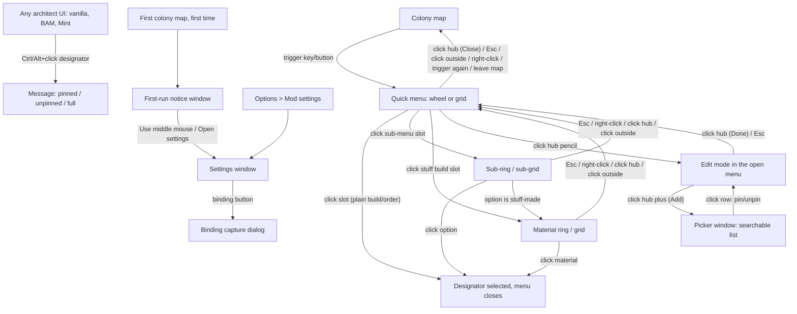

# Design: rimworld-quick-menu

- **Status**: approved (2026-10-19)
- **Spec**: [spec.md](spec.md) · **Architecture**: [architecture.md](architecture.md) · **Assets**: [assets.md](assets.md)
- **Mockups**: [wheel and slot states](design/mockup-wheel-states.png) · [material sub-ring and grid edit mode](design/mockup-subring-grid-edit.png) · [settings and picker](design/mockup-settings-picker.png). Source: [design/mockups/make_mockups.py](design/mockups/make_mockups.py). The script uses the geometry in §1.1, so the mockups also check the layout maths. Icons in the mockups are neutral placeholders; in the game, slots show the game's own designator icons. Where a mockup and this text disagree, this text wins. (Known gap: the binding capture is drawn inline in the mockup, but it is a dialog per ADR-0003.)
- Sections that do not apply say "N/A because …".

**Look in one sentence:** a translucent black disc with a thin cyan rim, round dark slots that hold the game's designator icons, and vanilla RimWorld window chrome for everything else. It is close to the Mint wheel, but every texture is made by our own code (NFR-7).

**Units:** all sizes are in RimWorld **UI pixels** (`UI.screenWidth/Height`, `UI.MousePositionOnUIInverted`). The game scales UI pixels by `Prefs.UIScale` (NFR-5).

**Host and drawing constraints (from ADR-0007):**
- The menu is a full-screen, transparent, non-pausing `Verse.Window`, drawn with vanilla IMGUI.
- **No rotated drawing** (`GUI.matrix` / `GUIUtility.RotateAroundPivot`). Every orientation (badges, caret, hub icons) is baked into a texture.
- Designator icons are drawn with `Command.DrawIcon`.
- Vanilla sounds only.

---

## 1. UX

### Information architecture

### 1.1 Layout geometry (exact; implemented in `QuickMenu.Core.Layout`, ADR-0002)
These rules are written so Core can implement them exactly and test them against the numbers given. All values are floats in UI pixels. Placement output is the slot centre plus a hit shape.

**Inputs and constants**
| Symbol | Meaning | Value |
|---|---|---|
| `B` | button (slot) diameter | setting, 36–96, step 4, default **56** |
| `G` | gap between slots | **8** (constant) |
| `P` | pitch | `B + G` (default 64) |
| `rimPad` | disc/panel padding outside the outermost slot edge | **12** |
| `e` | hub sub-button diameter (Edit / Add) | `clamp(round(0.36·B), 18, 28)`; default **20** |
| `ey` | hub sub-button centre offset below the hub centre | `max(B/2 − e/2 − 2, e/2 + 6)`; default **16** |
| `plateH` | label plate height (Small font line height + 8) | **30**. The adapter passes it in from `Text.LineHeight`. |
| `plateGap` | gap between the rim and the label plate | **8** |
| `margin` | minimum distance from the screen edge | **8** |
| `screen` | UI screen size | `UI.screenWidth`, `UI.screenHeight` |

**Ring capacity.** `cap(k) = floor(π / asin(1 / (2k)) + 1e-9)` for k ≥ 1. The epsilon matters: for k = 1 the exact value is 6, and float error can give 5.999…. Core must have a unit test for the table: **k = 1…8 → 6, 12, 18, 25, 31, 37, 43, 50.** The rule guarantees adjacent centres on a ring are ≥ P apart (chord `2·k·P·sin(π/cap)` ≥ P). Rings are `k·P` apart radially, so circles of diameter B never overlap.

**Wheel (main)**
- Ring k radius `R_k = k·P`, k = 1 … `rings`.
- **Fixed**: capacity = Σ_{k=1..rings} cap(k). Slot index s maps to ring k and position i in fill order: ring 1 i = 0 … cap(1)−1, then ring 2, and so on. Angle `θ = −90° + i·360°/cap(k)`, measured clockwise from 12 o'clock in screen space (y down). Centre = `(cx + R_k·cos θ, cy + R_k·sin θ)`. Empty and reserved slots keep their positions.
- **Auto**: `count` = number of visible pins. The menu uses the smallest `m ≥ 1` with Σ_{k≤m} cap(k) ≥ count. Inner rings are full. The outer ring holds `c = count − Σ_{k<m} cap(k)` items **spread evenly**: `θ = −90° + i·360°/c`. With count = 0 the menu draws ring-1 geometry (disc for m = 1) with no slots. In edit mode Auto adds one "append" empty slot, computed as count + 1.
- **Auto full**: when count = Σ_{k≤m} cap(k) and the bounding box for m + 1 rings does not fit inside `screen − 2·margin` (either axis), or m = 8. Fixed full: every slot is occupied (reserved slots count as occupied).
- **Rings setting** range 1–5 (6 / 18 / 36 / 61 / 92 slots). Default 2 (18).
- **Disc radius** `D = m·P + B/2 + rimPad` (m = rings in use). Default D = 168.
- **Hub** (close/edit, user decision 2026-10-19): drawn as a circle of diameter B at the centre. It has two targets:
  - **Sub-button** (Edit in use mode, Add in edit mode): a circle of diameter `e` centred at `(cx, cy + ey)`, hit radius `e/2`. The offset keeps its top edge ≥ 6 px below the centre, where the mouse starts, at every B. Its bottom edge stays inside the hub hit area for B ≥ 40. At B = 36 it reaches 2 px past it, and the sub-button takes priority there.
  - **Main area** (Close in use mode, Done in edit mode): the hub hit area minus the sub-button. Hub hit area = distance ≤ `P/2` from the centre (wheel) or the centre cell (grid).
  - Defaults (B = 56): hub hit radius 32; sub-button spans y +6 … +26.
- There are no buttons on the rim.
- **Label plate**: horizontally centred on cx. Top = `cy + D + plateGap`. Width = text width + 12, max `2·D`.
- **Bounding box (for edge dodging)**: x `cx ± D`; y top `cy − D`, y bottom `cy + D + plateGap + plateH`. With the defaults: 336 wide, top −168, bottom +206.

**Grid (main)**
- `cols` ∈ {3, 5, 7, 9, 11}, default **5**. `rows` ∈ {1, 3, 5, 7}, default **3**. Odd numbers only, so the centre cell sits under the mouse.
- Cell (r, c) centre = `(cx + (c − (cols−1)/2)·P, cy + (r − (rows−1)/2)·P)`. The centre cell `(rows−1)/2, (cols−1)/2` is the **hub**. It is drawn and hit-tested as in the wheel, except that the main-area hit is the whole centre cell minus the sub-button.
- Slot order: reading order (r, then c), skipping the hub. Fixed capacity = `rows·cols − 1` (default 14).
- **Auto**: columns from the setting. Rows = the smallest odd `rows ≥ 1` with `rows·cols − 1 ≥ count` (edit mode: count + 1). Items fill in reading order. Full when count = rows·cols − 1 and `rows + 2` does not fit, or rows = 9.
- **Panel rect**: `x = cx − (cols·P − G)/2 − rimPad`, width `cols·P − G + 2·rimPad`. The same rule applies vertically with rows. Corner radius 10.
- Label plate centred on cx, top = panel bottom + plateGap.
- Bounding box = panel ∪ plate.

**Hit testing**
- Wheel and satellites: a slot is hit when the distance from its centre is ≤ `P/2`, so there are no dead gaps. If two match (only possible exactly on a boundary), the lower slot index wins.
- Grid and sub-grids: a slot is hit inside its `P × P` square cell.
- Hub: the sub-button first (distance ≤ e/2 from `(cx, cy + ey)`), then the main area (wheel: distance ≤ P/2; grid: centre cell). The sub-button has priority over everything.
- "Inside the menu" = inside the disc (distance ≤ D) or panel rect, or on the label plate. Anything else is **outside**.

**Sub-menu and material placement (`Core.Layout.SubMenu`)**
- **Wheel satellite** for `n` options, around the parent slot centre `(px, py)`. The satellite uses the smallest `m` with Σ_{k≤m} cap(k) ≥ n. Inner rings are full; the outer ring is spread evenly (the same rule as the Auto wheel). Radius `R_k = k·P`; disc `D_s = m·P + B/2 + rimPad`. Its hub is the parent slot itself, redrawn on top in the "open parent" state. Its bounding box is the disc plus the label plate below. It is edge-dodged on its own. If dodging moves it, the hub moves with the disc and shows the parent's icon, so the satellite is never detached from its own centre.
- **Grid sub-grid** for `n` options: `scols = min(ceil(√n), 6)`, `srows = ceil(n / scols)`. Cells use pitch P with the same panel padding. Reading order, no hub.
  - Side: right if `px ≥ cx` (the centre column counts as right), else left.
  - Right: the sub-panel's left edge = main panel right edge + G. Left: the sub-panel's right edge = main panel left edge − G.
  - Vertical: the first row's cell centre y = py.
  - If the chosen side overflows the screen horizontally, try the other side. Then apply EdgeDodge.
- **Material ring/grid** uses the same rules with n = number of materials, ordered by `StuffOrdering` (last-used first = index 0 = 12 o'clock or top-left). If the material ring opens from a sub-menu option, it **replaces** the sub-ring or sub-grid at the same anchor (the original parent position), and the hub shows the chosen option.
- n = 1 → no ring (FR-12). n = 0 → the parent is greyed.

**Edge dodging (`EdgeDodger.Fit`)**: allowed area = `[margin, screen − margin]` on each axis. If the bounding box is wider or taller than the allowed area on an axis, it is centred on that axis. Otherwise it is shifted by the minimum amount on that axis. The shift applies to the whole menu, so the mouse may no longer be over the hub. That is acceptable (FR-3).

**Worked defaults (for tests)**: B = 56, wheel, 2 rings: ring 1 radius 64 with 6 slots at −90°, −30°, 30°, 90°, 150°, 210°; ring 2 radius 128 with 12 slots every 30° from −90°; D = 168. Grid 5 × 3: panel 336 × 208; hub = cell (1, 2); 14 slots.

### 1.2 Key screens and states

#### S1. Quick menu, wheel layout (FR-2, FR-3, FR-4, FR-5, FR-6, FR-13). See [mockup](design/mockup-wheel-states.png).
The menu opens in the trigger frame, with geometry from §1.1. Drawing order:
1. disc
2. slots
3. hub (S4a)
4. label plate (hovered slot's label, Small font)
6. satellite (if open)

The main menu is drawn at 45% opacity while a satellite is open, and it does not react to the mouse.

#### S2. Quick menu, grid layout. See [mockup](design/mockup-subring-grid-edit.png) (right side).
The same as S1, with a rounded panel instead of the disc and the hub in the centre cell.

#### S3. Sub-menu (FR-11) and material choice (FR-12). See [mockup](design/mockup-subring-grid-edit.png) (left side).
- Clicking a sub-menu slot opens the satellite (wheel) or sub-grid (grid). The parent keeps a 2 px accent rim ("open parent").
- Material options show the material's icon in its stuff colour. The last-used material is first, with a 3 px accent rim.
- **Back** (one level): Esc, right-click anywhere, a click on the satellite hub, or a click outside the satellite or sub-grid. On the main level, the same inputs close the menu.
- **Hold mode**: hovering a sub-menu or material slot for **150 ms** opens its ring (the dwell stops rings from opening while the mouse passes over). Releasing over an option picks it. Releasing anywhere else closes everything.
- **Satellites do not open in edit mode.**

#### S4. Slot component: complete state list (one drawing routine for all layouts). See [mockup](design/mockup-wheel-states.png) (legend).
The slot is a circle of diameter B. The icon is drawn with `Command.DrawIcon` in a square of 0.75 B centred on the slot, so the game applies icon proportions, angle and stuff colour. Badges are fixed-orientation textures, each on its own 45° diagonal at radius B/2 so they never collide: **1:30** sub-menu, **4:30** material, **7:30** lock, **10:30** insert caret.

| # | State | Visual | Behaviour |
|---|---|---|---|
| 1 | **Normal** | `slotBg` fill at 92% + 1 px `slotBorder` ring | Hover → 2 |
| 2 | **Hover** | `slotBgHover` + 2 px `accent` ring + 8% white overlay; label plate shows the name | Vanilla `Mouseover_Command` sound once on enter; vanilla tooltip after the vanilla delay |
| 3 | **Pressed** | `slotBgPressed` while the button is held | Activate on release inside the slot |
| 4 | **Last-used material** | 3 px `accent` ring, no caret | Material ring/grid only |
| 5 | **Greyed with reason** (FR-14) | Icon tinted `unavailableIcon`, lock badge at 7:30 (`textMuted`). Also used for "no materials". | Tooltip: designator tooltip + reason in `danger`. Click: `ClickReject` + `RejectInput` message with the reason. Reason = `disabledReason`, or our composed reason for hidden designators (research, tech level, required building, and so on), or the fallback **"Not available right now."** |
| 6 | **Empty** (Fixed, use mode) | `slotBg` at 70% + 1 px `emptyBorder` | No hover, no click |
| 7 | **Empty** (edit mode) | Dashed `emptyBorder` ring + plus glyph | Click → becomes the insert cursor (10) |
| 8 | **Reserved-missing** (pin from a mod that is not loaded) | Use mode: **invisible but reserved** (Fixed: drawn exactly as Empty (6); Auto: not in the layout). Edit mode, Fixed: dashed ring + "?" glyph. | Edit-mode tooltip: "{label}\nFrom {mod}, which is not loaded. It comes back when the mod is added back.\nRight-click to remove." Pins and the picker skip it. Right-click removes it. Auto: managed from settings (S7 "Forget missing pins") |
| 9 | **Drag source** (edit) | Dashed empty ghost in place. The dragged icon follows the mouse at 0.9 B and 80% opacity, offset (+16, +16). | Drag starts after 6 px of movement (less movement is a click) |
| 10 | **Insert cursor** (edit, FR-9) | 3 px `accent` ring + 22% `accent` tint + caret at 10:30 | Fixed: the next pin goes **into** this slot. Auto: the next pins go **in front of** it. Click again to clear it. |
| 11 | **Drop target** (edit) | `slotBgHover` + 2 px `accent` ring + 22% `accent` tint | Release → swap |
| 12 | **Sub-menu** (FR-10/11) | Dropdown corner badge at 1:30 | Click → satellite or sub-grid |
| 13 | **Material** (FR-12) | Dot of 0.18 B in the last-used stuff colour (or `textMuted` if there is none), dark outline, at 4:30 | Click → material ring (1 option: activate directly) |
| 14 | **Open parent** | 2 px `accent` ring, drawn in full opacity above the dimmed menu | Hub of the satellite |

States 12 and 13 combine with 1–5, and 10 and 11 combine with 12 and 13.

#### S4a. Hub: close/edit (user decision 2026-10-19). See [mockup](design/mockup-wheel-states.png).
The hub is designed so that accidents are harmless:
- The **main area** only closes the menu, which is the same result as clicking outside.
- **Edit** is a small separate target below the centre, where the mouse is not when the menu opens. It needs a deliberate click (mouse down and up inside it), and a **hold-mode release over it is ignored**: it cancels like the rest of the hub.

| Mode | Main area (large) | Sub-button (small, below centre) |
|---|---|---|
| Use mode | **Close**: `slotBg` at 60% + 1 px `slotBorder` ring; × glyph (`IconClose`, 0.22 B, `textMuted`) centred at `(cx, cy − 0.12 B)`. Click → close. Hold-mode release → close (cancel). | **Edit**: `Circle` in `slotBg` + 1 px `accent` ring + pencil (`IconEdit`, 0.6 e, `text`). Left click (down and up inside) → edit mode. Hold-mode release → close, like the main area. |
| Edit mode | **Done**: as above with 2 px `accent` ring and check glyph (`IconDone`). Click → leave edit mode. | **Add**: plus glyph (`IconAdd`). Click → opens the picker. |
| Satellite / sub-grid | The satellite's centre is the parent slot ("open parent", state 14). Click → back. There is no sub-button. | — |

- **Hover**: main area → `slotBgHover` + 2 px `accent` ring, × in `text`, label plate "Close" (edit mode: "Done"). Sub-button → `slotBgHover` + 2 px `accent` ring, label plate "Edit" (edit mode: "Add from the list").
- **No hover on open**: the mouse starts on the main area. Its hover highlight and label appear only after the mouse has moved ≥ 4 px since opening, so the menu does not open with "Close" lit up.
- **Pressed**: `slotBgPressed`. Right-click on the hub does nothing in edit mode and closes in use mode (as elsewhere).

#### S5. Edit mode (FR-9) and menu-level states. See [mockup](design/mockup-subring-grid-edit.png).
- **Enter**: left-click the hub's pencil sub-button (S4a). In hold mode the player clicks it while still holding the trigger. After that the menu stays open until Done or Esc, and releasing the trigger no longer closes it. A hold-mode **release** over the pencil does not enter edit mode.
- **In edit mode**: the hub main area becomes **Done** (check mark) and the sub-button becomes **Add** (plus, opens the picker).
- **Help panel**: shown at the **top centre of the screen** (60 px from the top, max width 520, `plate` background). It lives outside the menu so entering edit mode never changes the menu's position or dodging. It contains the Fixed or Auto help text (§1.4) and a **capacity line**: "12 of 18 slots used" (Fixed) or "12 pinned" (Auto).
- **Menu full** (FR-5): the capacity line turns `danger` with "The menu is full." Pinning (picker, modifier+click, Add) then plays `ClickReject` and shows the full message (S9). In Fixed with an insert cursor on an occupied slot, a pin replaces nothing; it still reports full.
- **Exit**: Done or Esc. The first Esc leaves edit mode; a second Esc closes the menu. A left-click outside does nothing in edit mode, so edit state is never lost by accident.
- **Empty hint** (FR-16): when there are no visible pins and the menu is not in edit mode, the label plate is replaced by a hint plate (max width 360, wraps): "Nothing pinned yet. Click the pencil in the centre to add items, or {modifier}+click any build or order button." Fixed draws its empty slots. Auto draws a ring-1 disc with no slots. The hub is always shown.

#### S6. Picker window (FR-7, FR-10). See [mockup](design/mockup-settings-picker.png) (right side).
- A vanilla dialog `Window`: 540 × 680, clamped to the UI screen minus 40 (min 400 × 420). Draggable, close X, does not pause, sits above the menu window. The menu stays open behind it so the insert cursor stays visible.
- **Title** (Medium): "Add to the quick menu".
- **Search**: vanilla `QuickSearchWidget`, focused on open. Matches label, category and mod name. Enter pins when exactly one row matches.
- **Status line** (Small, `textMuted`): "New pins go in front of: {0} · 7 of 18 slots used". The first part shows only when an insert cursor is set; "in front of" becomes "into" in Fixed. When full, the line is `danger`: "The menu is full."
- **List**: grouped by architect category. Headers use Tiny bold uppercase in `textMuted`.
  - Rows are 40 px: a 32 px `Command.DrawIcon` on a `slotBg` tile (with the sub-menu badge if it is a dropdown), the label (Small), and a sub-line (Tiny, `textMuted`): "{category} · {mod}".
  - Pinned rows show a "Pinned" pill (accent outline and text).
  - Sub-menu rows have a disclosure triangle that shows their children, indented 24 px. Each child can be pinned on its own; the parent row pins the whole sub-menu.
  - Greyed rows: icon tint `unavailableIcon`, with the reason in the sub-line in `danger`. They can still be pinned, because availability changes during play.
  - Dev-only items are listed under "DEV MODE ONLY", and only in dev mode.
  - Hover = 7% white highlight. Tooltip = the designator tooltip.
  - Only visible rows are drawn (virtualised).
- **Click a row**: pin or unpin (FR-15), with `Tick_High` or `Tick_Low`. The window stays open.
- **States**: building the index on first open → "Building list…"; no results → "Nothing matches “{0}”."
- **Footer**: "Click to pin or unpin. The list stays open." and [Close].

#### S7. Mod settings window (FR-1, FR-2, FR-5, FR-6, FR-8). See [mockup](design/mockup-settings-picker.png) (left side).
Two columns inside `DoSettingsWindowContents` (about 860 × 580), using vanilla widgets only. Accent marks only the selected segment.

**Left column, "Opening the menu"**
- **Open menu with** [binding button] [Clear].
  - Labels: "Mouse 4", "Mouse 5", "Middle mouse", a key name, or "Unbound" (in `textMuted`).
  - Mouse indices from ADR-0003: index 2 = middle, 3 = "Mouse 4" (default), 4 = "Mouse 5".
- [Use middle mouse instead], hidden when the binding is already middle mouse.
- Note (Tiny, `textMuted`): "Mice do not report their side buttons. If Mouse 4 does nothing, use the middle mouse button or bind a key. Middle mouse also drags the camera while held."
- **Trigger mode**: ( ) Press to open, press again to close · ( ) Hold, release over a button.

**Left column, "Pinning"**
- **Pin with** [Ctrl ▾] "+ click on a build or order". Options: Ctrl, Alt, Shift.
- When Mint is active and the user has not chosen a modifier: "Dubs Mint Menus is active, so Alt is used and Ctrl+click stays with Mint."
- [Clear all pins…] opens a vanilla confirmation dialog.
- When missing pins exist: "{0} pins are from mods that are not loaded. They come back when the mods are added back." and [Forget missing pins].

**Right column, "Layout"**
- **Shape**: [Wheel] [Grid] segmented control.
- **Size**: ( ) Fixed ( ) Auto.
- **Rings** [−] 2 [+] "18 slots" for the wheel, or **Columns** [−] 5 [+] / **Rows** [−] 3 [+] "14 slots" for the grid (steps of 2). Hidden in Auto, except Columns for the grid.
- **Button size**: slider 36–96, step 4.
- **Preview** (410 × 270): the real layout from Core at 50% with blank slots, updated live.
  - Warning in `danger` if the bounding box does not fit the screen at the current UI scale: "At this UI scale the menu is bigger than the screen and will be centred."
  - Fixed shrink note: "{0} pins are outside the menu and stay hidden until you make it bigger again." The pins are kept.

**Bottom left**: [Reset to defaults]. It does not clear pins.

**Binding capture dialog** (`BindingCaptureWindow`, ADR-0003)
- A small vanilla modal, 360 × 150, title "Set the menu button".
- Body: "Press a key or a middle or side mouse button.\nEsc cancels."
- Mouse buttons are read by polling, keys from key events.
- **Left and right mouse buttons are rejected**, with the inline `danger` text "Left and right click can't open the menu." and `ClickReject`.
- If the key is already used by a game key binding, the dialog accepts it and shows the `danger` warning "{key} is also used for: {binding}." on the settings row.

#### S8. Notices (FR-1, FR-8)
- **First-run notice**: a vanilla `Window`, 460 × ~190, top centre. It does not pause and does not close on an outside click. It is shown once, the first time a colony map is entered (`firstRunNoticeShown`).
  - Title "Quick Menu is ready" (Medium).
  - Body: "Press Mouse 4 (a side mouse button) on the map to open the quick menu. No side button? Use the middle mouse button instead."
  - Buttons: [Use middle mouse] [Open settings] [OK].
  - If Mint is active, it adds the Mint line below and also sets `mintNoticeShown`.
- **Mint notice** (`mintNoticeShown`): when Mint becomes active after the first run, a one-time `NeutralEvent` message: "Dubs Mint Menus is active: pin with Alt+click, so Ctrl+click stays with Mint. You can change this in the Quick Menu settings."

#### S9. Messages (FR-5, FR-8, FR-14, FR-15)
Modifier+click scope (U-3): on an entry inside an open dropdown list it pins that single entry; on the dropdown button it pins the whole dropdown.

All use vanilla `Messages.Message`, with `historical: false`:
- "Pinned {0} to the quick menu." (`SilentInput`, `Tick_High`)
- "Removed {0} from the quick menu." (`SilentInput`, `Tick_Low`)
- "The quick menu is full. Make it bigger in the mod settings or switch to Auto size." (`RejectInput`, `ClickReject`)
- An unavailable slot was clicked: the reason (`RejectInput`, `ClickReject`).

#### Tooltips
- **Slot**: the designator's own gizmo tooltip (label, description, cost), followed by one line of ours in `textMuted`:
  - "Click to open ({0} items)." for a sub-menu
  - "Material: {0}. Click to choose." for a stuff-made build
  - the reason in `danger` when greyed
  - "Drag to move. Right-click to remove." in edit mode
- Tooltips use the vanilla delay and position. The instant label plate gives the name without waiting.
- **Hub**: Close "Close the menu (Esc)"; Edit "Edit the quick menu"; Done "Finish editing (Esc)"; Add "Add from a list of everything in the architect menu".

#### Close and cancel rules
| Input | Main level | Satellite/sub-grid open | Edit mode |
|---|---|---|---|
| Esc | close | back | leave edit mode |
| Right-click | close | back | clear the slot under the mouse (else nothing) |
| Left-click outside | close | back | nothing |
| Left-click hub main area | close | back (satellite hub) | Done (leave edit mode) |
| Left-click hub sub-button | edit mode | — | Add (picker) |
| Trigger released (hold) over the hub (either part) | close | — | stay open |
| Trigger pressed again (toggle) | close | close | close |
| Trigger released (hold) | pick hovered slot or close | pick hovered option or close | stay open |
| Map changes / world view | close | close | close |

### 1.3 Responsive behaviour
RimWorld has no breakpoints. What changes is the **UI screen size** = resolution ÷ `Prefs.UIScale` (NFR-5).
- All geometry is in UI pixels, so it follows the UI scale.
- At UI scale 2.0 on 1920 × 1080 (UI screen 960 × 540), the default wheel (bounding box 336 × 374) fits. A 4-ring Fixed wheel (D = 296) does not, so it is centred. Auto counts as full sooner. The settings preview warns.
- Textures are drawn at UI size. Our mask textures are authored at a resolution that stays sharp up to B = 96 at UI scale 2 (see §6).
- The picker and dialogs clamp to the UI screen.
- Verification: in-game screenshots at UI scale 1.0 and 2.0, wheel and grid, every S4 state (architecture.md §9, visual review).

### 1.4 Copy
All strings go in `mod/Languages/English/Keyed/QuickMenu.xml`, with keys prefixed `QuickMenu.` (NFR-4). The strings are given in S5–S9. Additional strings:
- Size tooltip: "Fixed: a set number of slots that stay in place, with empty slots shown.\nAuto: the menu grows as you pin more."
- Shape tooltip: "Wheel: rings around the mouse.\nGrid: rows and columns around the mouse."
- Edit help, Fixed: "Click a slot to choose where the next pin goes.\nAdd from the list, or {0}+click any build or order button.\nDrag a slot onto another to swap them. Right-click to clear a slot.\nDone or Esc to finish."
- Edit help, Auto: "Click a slot to put new pins in front of it.\nAdd from the list, or {0}+click any build or order button.\nDrag a slot onto another to swap them. Right-click to remove one.\nDone or Esc to finish."
- Unavailable fallback: "Not available right now."

## 2. Design system
The game's UI is dark only, so there is one theme. Tokens live in one adapter class (for example `QMStyle`), and the layout constants in §1.1 live in Core. No drawing code uses literals.

### Color tokens
| Token | Light | Dark | Use | Contrast (vs bg) |
|---|---|---|---|---|
| `accent` | N/A (no light theme) | `#38BDF8` | Rim, hover/insert/target rings, Pinned pill, selected segment | 7.4:1 vs `slotBg`; 8.3:1 vs `windowBg` |
| `discCentre` → `discEdge` | — | black α 0.85 → α 0.55 (radial) | Disc and panel fill | slot vs edge over snow 3.3:1 |
| `rimOutline` | — | black α 0.60, 1 px on each side of the 2 px rim | Keeps the rim visible over bright ground | Required: accent vs bare edge over snow is 2.2:1; with the outline, ≥ 9.8:1 against the adjacent colour |
| `slotBg` | — | `#1E2328` α 0.92 | Slot fill, picker icon tile | — |
| `slotBgHover` | — | `#2A3540` | Hover, drop target | accent ring on it 5.8:1 |
| `slotBgPressed` | — | `#15191D` | Pressed | — |
| `slotBorder` | — | `#56626E` | Normal slot ring (decorative) | 2.5:1 (decorative; the fill carries the shape) |
| `emptyBorder` | — | `#8A96A0` | Empty, dashed and reserved slots | ≥ 3:1 vs empty fill over dark ground |
| `text` | — | `#FFFFFF` | Labels, plates | 15.8:1 vs slotBg; 12.6:1 on plate over snow |
| `textMuted` | — | `#A7B0B8` | Secondary text, lock badge, headers | 7.2:1 vs slotBg; 5.7:1 on plate over snow |
| `danger` | — | `#FF7A70`, or the game's `ColorLibrary.RedReadable` if it is within 3:1 of this value | Reasons, warnings, full | 6.2:1 vs slotBg; 7.0:1 vs windowBg |
| `unavailableIcon` | — | `#808080` α 0.75 (multiplied into the icon) | Greyed icons | 4.0:1 vs slotBg, always paired with the lock badge |
| `plate` | — | black α 0.80 | Label, hint and help plates | — |
| `dimmedMenu` | — | menu α 0.45 | Main menu behind a satellite | — |
| windows, buttons | — | the game's own (`Widgets.WindowBGFillColor`, vanilla button atlas) | Settings, picker, dialogs | vanilla |

Target: **WCAG 2.2 AA** (text ≥ 4.5:1, UI parts ≥ 3:1). Every text pair passes.

### Typography
- Game fonts only, through `Text.Font`. We ship no font files.
- **Tiny**: picker sub-lines, headers, notes.
- **Small** (the default): label/hint/help plates, settings, picker rows.
- **Medium**: dialog titles.
- One-line text is truncated with the game's `Truncate`. Plates wrap at their max width.

### Spacing, radius, elevation
- **Spacing (UI px)**: 2, 4, 6, 8, 12, 16, 24. The layout constants are in §1.1.
- **Badges**, relative to B: sub-menu 0.22 B, material dot 0.18 B, lock 0.25 B, caret 0.2 B.
- **Radius**: slots are circles. Grid panel 10. Plates 3. Picker icon tile 3. Pill 10.
- **Ring widths**: disc rim 2 + outlines 1 + 1. Hover, target and open parent 2. Insert and last-used 3. Normal and empty 1.
- **Elevation**: none on slots. The hub draws above the slots. Satellites draw above the dimmed menu. Windows use vanilla shadows.

### Motion
- No animation in v1. The menu appears in the trigger frame, and state changes are instant. RimWorld has no reduced-motion preference, so a lack of motion is the accessible default.
- The only timed behaviour is the 150 ms hold-mode dwell. It is not animated.

### Components
| Component | States | Built from |
|---|---|---|
| Disc | normal, dimmed | `Disc` mask (gradient) + `Ring2` mask (rim) + outline rings, tinted |
| Grid panel | normal, dimmed | 9-slice `Panel` mask drawn with `Widgets.DrawAtlas` + 9-slice `PanelRim` |
| Hub (S4a) | Close / Done main area; Edit / Add sub-button; each normal, hover, pressed; no hover until the mouse moves 4 px | `Circle` + `Ring1/2` + `IconClose`/`IconDone` (main), `Circle` + `Ring1/2` + `IconEdit`/`IconAdd` (sub-button) |
| Slot | S4 states 1–14 | `Circle` (fill), `Ring1/2/3` (rings), `RingDashed`, badges, `Command.DrawIcon` |
| Plate (label, hint, help) | — | 9-slice `Plate` mask |
| Binding row + capture dialog | bound, unbound, capturing, rejected, conflict warning | vanilla buttons and a dialog |
| Segmented control, stepper, slider | selected / unselected; disabled at the limits | vanilla buttons with an `accent` outline for the selected segment |
| Picker row | normal, hover, pinned, greyed, dev-only, expanded/collapsed | `Command.DrawIcon` + vanilla text |
| Preview | normal, "does not fit" | Core layout at 50% |
| Notices and messages | — | vanilla `Window` / `Messages` |

## 3. Art direction
- **Style**: functional HUD. A dark translucent disc so the colony stays visible, one cyan accent, and round slots that put the game's icons first. It is "Mint-like" in feel (the user likes the reference), drawn entirely by our code with our own values: a stronger edge alpha, a dark outline on the rim, and our own accent hex. No Mint file is used, traced or converted.
- **Palette**: §2. Icons bring their own colour.
- **Resolution/scale**: all our shapes are **white or grayscale alpha masks**, tinted with `GUI.color` at draw time, so one mask serves every state. Circles and rings are made by an anti-aliased distance-field rasterizer at mask size **256 px** (rings: stroke widths authored for 256 px, per ring width; see §6). The icons are drawn on a 64 px grid with a 4 px margin and 6 px strokes.
- **No rotation at draw time**: every badge, the caret and the hub icons are rasterized in their final orientation.
- **Animation**: none.

## 4. Audio direction
Mostly N/A, because spec §8 allows only vanilla UI sounds. No audio files are added. Events are mapped to vanilla `SoundDefOf` entries.

### Sound list
| ID | Sound | Trigger | Duration | Loop | Variations | Priority |
|---|---|---|---|---|---|---|
| SND-1 | none (user decision) | Menu opens | — | — | — | — |
| SND-2 | `Mouseover_Command` | Pointer enters a slot or picker row | game | no | game | Low |
| SND-3 | Designator's own activate sound (through the game path, ADR-0006) | Slot or option picked | game | no | game | High |
| SND-4 | `Tick_High` / `Tick_Low` | Pin / unpin | game | no | game | Med |
| SND-5 | `ClickReject` | Unavailable slot, menu full, binding rejected | game | no | game | Med |
| SND-6 | `Tick_Tiny` | Swap dropped, satellite opened | game | no | game | Low |

### Technical spec
N/A, because there are no audio assets. Sounds are played with `PlayOneShotOnCamera`.

### Mixing
N/A, because the game's UI volume applies.

## 5. Accessibility
- **Target**: WCAG 2.2 AA where it applies. Contrast results are in §2.
- **Size (NFR-5)**: B is 36–96 UI px, multiplied by the game's UI scale. The smallest targets (36 px slots, 28 px buttons) are above the 24 px minimum of WCAG 2.5.8.
- **Not colour alone**: the insert cursor has a caret; greyed slots have a lock badge and a reason; pinned rows have a text pill; sub-menus have a corner badge; reserved slots have a "?" glyph; full has text.
- **Keyboard**: the trigger can be a key. Esc works at every level. The picker search field gets focus on open, and Enter pins a single match. Slot selection by keyboard is future scope.
- **Reading**: the instant label plate in Small font; short, plain hint and help text.
- **Reduced motion**: there is no motion.
- **Screen readers**: N/A, because IMGUI exposes no accessibility tree.
- **Hold mode** has the toggle alternative (the default).
- **Audio**: every sound has a visual counterpart.

## 6. Asset strategy and pipeline
| Asset type | Strategy (code / SVG / library / generated / user-supplied) | Tool or source | Cost |
|---|---|---|---|
| Shape masks: `Circle`, `Disc` (radial gradient), `Ring1`, `Ring2`, `Ring3`, `RingDashed`, `Panel`, `PanelRim`, `Plate` (9-slice), badges `SubMenuBadge`, `Caret`, `Lock`, icons `IconClose`, `IconEdit`, `IconDone`, `IconAdd` | **Code**: one pure rasterizer in `QuickMenu.Core` (`Render.MaskRasterizer`: signed-distance shapes → `byte[]` alpha). **Primary**: uploaded at startup into `Texture2D` (`SetPixels32` + `Apply`). **Fallback**: the same rasterizer exports PNGs into `mod/Textures/QuickMenu/UI/`, loaded with `ContentFinder`. | C# (Core, unit-testable: pixel checks such as "centre alpha = 255, corner = 0") + `scripts/export-masks` (a small console entry or test) | Free. About 15 masks of ≤ 256², generated once at startup in a few ms |
| Designator icons | **Game**: `Command.DrawIcon` | RimWorld and mods | Free |
| Window chrome, buttons, search widget, close X | **Game** widgets (vanilla `Widgets`, `QuickSearchWidget`, `TexButton`) | RimWorld 1.7 | Free; not redistributed |
| Workshop preview `mod/About/Preview.png` | **Made by us**: an in-game screenshot of our menu + title text, 2.468:1 (for example 1234 × 500) | Screenshot + `magick` script | Free (MIT) |
| Mockups (docs only) | Scripted SVG → PNG | `docs/project/design/mockups/make_mockups.py` | Free |

**Decision: runtime-generated masks are the primary path; shipped PNGs of the same masks are the fallback.** This is the reconciliation with ADR-0007, which asks for "own grayscale PNGs tinted in code". Both paths use the **same grayscale masks tinted with `GUI.color`**; only the delivery differs.
- **Why runtime first:**
  - It does not depend on the open question of whether loose PNGs in a mod's `Textures/` load on 1.7 (the game itself ships baked `.dds` files in `Assets.zip`, and Mint 1.7 ships both formats).
  - `Texture2D` + `SetPixel(s32)` + `Apply` is used by Mint's 1.7 assembly, so it works under UnityStubs.
  - There are no binary files to review or keep in sync.
- **Fallback trigger:** if spike **S-7** shows that runtime textures fail (exceptions, wrong alpha, not drawn), switch `UI.Textures` to `ContentFinder<Texture2D>.Get("QuickMenu/UI/<Name>")` and commit the exported PNGs (each gets a row in assets.md). If loose PNGs fail too, add a bake step with the game's `Waylith.AssetBake` (as Mint's `Assets.zip` suggests).
- **Shape-specific notes:**
  - Rings at 256 px are downsampled to B (as small as 36 px), and at small sizes the thin lines lose weight. So ring masks are rasterized with stroke widths for their typical drawn size: `Ring1/2/3` at 128 px with 2.3/4.6/6.9 px strokes (≈ 1/2/3 px at B = 56).
  - On the runtime path, if a rebuild per (B × UIScale) is wanted, it costs ≤ 5 ms and runs only when settings or the scale change, never per frame.
  - Textures use bilinear filtering, mipmaps off, clamp wrap.
- **Spike S-7 (to add to the architecture's spike list, owner: developer with visual-designer review):**
  1. Create a `Texture2D(256, 256, RGBA32, false)` in a `[StaticConstructorOnStartup]` class, fill it with `SetPixels32`, `Apply()`, and draw it with `GUI.DrawTexture` under `GUI.color` tint at α 0.5 in a test window. Check that the alpha, tint and bilinear scaling look right at UI scale 1.0 and 2.0.
  2. Put a test PNG in `mod/Textures/QuickMenu/UI/` and load it with `ContentFinder`. Record whether it loads.
  3. Draw `Widgets.DrawAtlas` with a generated 9-slice.
  4. Save screenshots in `docs/project/design/spikes/`. Record the result in ADR-0007 and here.

### Technical needs (summary for the architecture; all satisfied by ADR-0002/0003/0006/0007 except S-7)
1. Per-frame drawing only while a menu, picker or notice window is open (ADR-0007).
2. Startup-time texture creation on the main thread (S-7).
3. The window absorbs map clicks and draws above the map; the picker and dialogs draw above it (S-6).
4. Raw polling of the trigger press and release, mouse indices 2–4 (ADR-0003).
5. `Command.DrawIcon` for all designator icons (ADR-0007).
6. Pure layout, hit testing, edge dodging and the mask rasterizer in Core (ADR-0002).
7. The renderer takes an origin and a scale (for the settings preview).
8. A virtualised picker list over a prebuilt index.
9. Game fonts only.
10. No rotated drawing.

## 7. Design decisions (user, 2026-10-19)
| ID | Decision |
|---|---|
| Q-D1 | Name "Quick Menu", packageId `sixdd.QuickMenu` |
| Q-D2 | Grid rows and columns are odd only |
| Q-D3 | No sound when the menu opens. Sounds are only for picking, pinning and rejects. |
| Q-D4 | The centre is a close/edit hub (S4a), not a dead zone |
| Q-D5 | Missing-mod pins in Auto are hidden in both modes and cleared with "Forget missing pins" in settings. In Fixed they keep a reserved slot that shows "?" in edit mode. |
| U-3 | Modifier+click on an entry inside an open dropdown list pins that single entry. On the dropdown button it pins the whole dropdown. |

No design questions are open.
