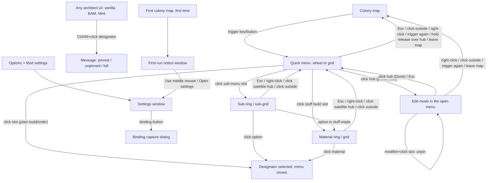

# Design: rimworld-quick-menu

- **Status**: approved (2026-10-19)
- **Spec**: [spec.md](spec.md) · **Architecture**: [architecture.md](architecture.md) · **Assets**: [assets.md](assets.md)
- **Mockups**: [wheel and slot states](design/mockup-wheel-states.png) · [material sub-ring and grid edit mode](design/mockup-subring-grid-edit.png) · [settings and picker](design/mockup-settings-picker.png). Source: [design/mockups/make_mockups.py](design/mockups/make_mockups.py). The script uses the geometry in §1.1, so the mockups also check the layout maths. Icons in the mockups are neutral placeholders; in the game, slots show the game's own designator icons. Where a mockup and this text disagree, this text wins. (Known gap: the binding capture is drawn inline in the mockup, but it is a dialog per ADR-0003.) **The picker half of the settings mockup, and the "+" slots, insert cursor and caret in the edit mockup, are obsolete** (user decision 2026-10-19: no picker, no Add, no insert cursor; see S5).
- Sections that do not apply say "N/A because …".

**Look in one sentence:** a translucent black disc with a thin cyan rim, round dark slots that hold the game's designator icons, and vanilla RimWorld window chrome for everything else. It is close to the Mint wheel, but every texture is made by our own code (NFR-7).

**Units:** all sizes are in RimWorld **UI pixels** (`UI.screenWidth/Height`, `UI.MousePositionOnUIInverted`). The game scales UI pixels by `Prefs.UIScale` (NFR-5).

**Host and drawing constraints (from ADR-0007):**
- The menu is a full-screen, transparent, non-pausing `Verse.Window`, drawn with vanilla IMGUI.
- **No rotated drawing** (`GUI.matrix` / `GUIUtility.RotateAroundPivot`). Every orientation (badges, hub icons) is baked into a texture.
- Designator icons are drawn with `Command.DrawIcon`.
- Vanilla sounds only.

---

## 1. UX

### Information architecture

### 1.1 Layout geometry (exact; implemented in `QuickMenu.Core.Layout`, ADR-0002)
These rules are written so Core can implement them exactly and test them against the numbers given. All values are floats in UI pixels. Placement output is the slot centre plus a hit shape.

**Inputs and constants**
| Symbol | Meaning | Value |
|---|---|---|
| `B` | button (slot) diameter | setting, 36–96, step 4, default **56** |
| `G` | gap between slots | **8** (constant) |
| `P` | pitch | `B + G` (default 64) |
| `rimPad` | disc/panel padding outside the outermost slot edge | **12** |
| `H` | hub button diameter (drawn) | `round(0.64·B)`; default **36** (B 36 → 23, B 96 → 61) |
| `Hg` | hub glyph size (pencil / check mark) | `round(0.5·H)`; default **18**. Both `H` and `Hg` round half away from zero (`MidpointRounding.AwayFromZero`) |
| `plateH` | label plate height (Small font line height + 8) | **30**. The adapter passes it in from `Text.LineHeight`. |
| `plateGap` | gap between the rim and the label plate | **8** |
| `margin` | minimum distance from the screen edge | **8** |
| `screen` | UI screen size | `UI.screenWidth`, `UI.screenHeight` |

**Ring capacity.** `cap(k) = floor(π / asin(1 / (2k)) + 1e-9)` for k ≥ 1. The epsilon matters: for k = 1 the exact value is 6, and float error can give 5.999…. Core must have a unit test for the table: **k = 1…8 → 6, 12, 18, 25, 31, 37, 43, 50.** The rule guarantees adjacent centres on a ring are ≥ P apart (chord `2·k·P·sin(π/cap)` ≥ P). Rings are `k·P` apart radially, so circles of diameter B never overlap.

**Wheel (main)**
- Ring k radius `R_k = k·P`, k = 1 … `rings`.
- **Fixed**: capacity = Σ_{k=1..rings} cap(k). Slot index s maps to ring k and position i in fill order: ring 1 i = 0 … cap(1)−1, then ring 2, and so on. Angle `θ = −90° + i·360°/cap(k)`, measured clockwise from 12 o'clock in screen space (y down). Centre = `(cx + R_k·cos θ, cy + R_k·sin θ)`. Empty and reserved slots keep their positions.
- **Auto**: `count` = number of visible pins. The menu uses the smallest `m ≥ 1` with Σ_{k≤m} cap(k) ≥ count. Inner rings are full. The outer ring holds `c = count − Σ_{k<m} cap(k)` items **spread evenly**: `θ = −90° + i·360°/c`. With count = 0 the menu draws ring-1 geometry (disc for m = 1) with no slots. Edit mode uses the same count (there is no "append" slot since the Add target was removed, user decision 2026-10-19).
- **Auto full**: when count = Σ_{k≤m} cap(k) and the bounding box for m + 1 rings does not fit inside `screen − 2·margin` (either axis), or m = 8. Fixed full: every slot is occupied (reserved slots count as occupied).
- **Rings setting** range 1–5 (6 / 18 / 36 / 61 / 92 slots). Default 2 (18).
- **Disc radius** `D = m·P + B/2 + rimPad` (m = rings in use). Default D = 168.
- **Hub** (the Edit button; user decision 2026-10-19, after UC-2, supersedes the earlier close/edit hub): drawn as a circle of diameter `H` centred at `(cx, cy)`, with its glyph (`Hg`) centred at `(cx, cy)`. It is **one target** with no sub-targets. **Hit area** = distance ≤ `P/2` from the centre (wheel) or the whole centre cell (grid), so the hit area is larger than the drawn circle (default: drawn 36, hit 64 across). The hub never closes the menu (S4a).
  - Defaults (B = 56): H 36, glyph 18, hit radius 32. At B = 36: H 23, glyph 12, hit radius 22 (44 across).
- There are no buttons on the rim.
- **Label plate**: horizontally centred on cx. Top = `cy + D + plateGap`. Width = text width + 12, max `2·D`. The menu's label plate is one line: a longer label is truncated with the game's `Truncate` once per open (T-29), so `plateH` stays fixed for the bounding box. (Hint and help plates still wrap.)
- **Bounding box (for edge dodging)**: x `cx ± D`; y top `cy − D`, y bottom `cy + D + plateGap + plateH`. With the defaults: 336 wide, top −168, bottom +206.

**Grid (main)**
- `cols` ∈ {3, 5, 7, 9, 11}, default **5**. `rows` ∈ {1, 3, 5, 7}, default **3**. Odd numbers only, so the centre cell sits under the mouse.
- Cell (r, c) centre = `(cx + (c − (cols−1)/2)·P, cy + (r − (rows−1)/2)·P)`. The centre cell `(rows−1)/2, (cols−1)/2` is the **hub**. It is drawn as in the wheel (circle `H` centred in the cell), and its hit area is the whole centre cell.
- Slot order: reading order (r, then c), skipping the hub. Fixed capacity = `rows·cols − 1` (default 14).
- **Auto**: columns from the setting. Rows = the smallest odd `rows ≥ 1` with `rows·cols − 1 ≥ count` (the same in edit mode). Items fill in reading order. Full when count = rows·cols − 1 and `rows + 2` does not fit, or rows = 9.
- **Panel rect**: `x = cx − (cols·P − G)/2 − rimPad`, width `cols·P − G + 2·rimPad`. The same rule applies vertically with rows. Corner radius 10.
- Label plate centred on cx, top = panel bottom + plateGap.
- Bounding box = panel ∪ plate.

**Hit testing**
- Wheel and satellites: a slot is hit when the distance from its centre is ≤ `P/2`, so there are no dead gaps. If two match (only possible exactly on a boundary), the lower slot index wins.
- Grid and sub-grids: a slot is hit inside its `P × P` square cell.
- Hub: one hit kind, `HubEdit` (wheel: distance ≤ P/2 from the centre; grid: the centre cell). There is no `HubClose` and no sub-target. Hub areas and slot areas do not overlap; the hub is tested before slots and is never a slot.
- "Inside the menu" = inside the disc (distance ≤ D) or panel rect, or on the label plate. Anything else is **outside**.

**Sub-menu and material placement (`Core.Layout.SubMenu`)**
- **Wheel satellite** for `n` options, around the parent slot centre `(px, py)`. The satellite uses the smallest `m` with Σ_{k≤m} cap(k) ≥ n. Inner rings are full; the outer ring is spread evenly (the same rule as the Auto wheel). Radius `R_k = k·P`; disc `D_s = m·P + B/2 + rimPad`. Its hub is the parent slot itself, redrawn on top in the "open parent" state. Its bounding box is the disc plus the label plate below. It is edge-dodged on its own. If dodging moves it, the hub moves with the disc and shows the parent's icon, so the satellite is never detached from its own centre.
- **Grid sub-grid** for `n` options: `scols = min(ceil(√n), 6)`, `srows = ceil(n / scols)`. Cells use pitch P with the same panel padding. Reading order, no hub.
  - Side: right if `px ≥ cx` (the centre column counts as right), else left.
  - Right: the sub-panel's left edge = main panel right edge + G. Left: the sub-panel's right edge = main panel left edge − G.
  - Vertical: the first row's cell centre y = py.
  - If the chosen side overflows the screen horizontally, try the other side. Then apply EdgeDodge.
- **Material ring/grid** uses the same rules with n = number of materials, in the architect's **fixed order** (`StuffOrdering` keeps it; the last-used material is highlighted, never moved to the front). If the material ring opens from a sub-menu option, it **replaces** the sub-ring or sub-grid at the same anchor (the original parent position), and the hub shows the chosen option.
- n = 1 → no ring (FR-12). n = 0 → the parent is greyed.

**Edge dodging (`EdgeDodger.Fit`)**: allowed area = `[margin, screen − margin]` on each axis. If the bounding box is wider or taller than the allowed area on an axis, it is centred on that axis. Otherwise it is shifted by the minimum amount on that axis. The shift applies to the whole menu, so the mouse may no longer be over the hub. That is acceptable (FR-3).

**Worked defaults (for tests)**: B = 56, wheel, 2 rings: ring 1 radius 64 with 6 slots at −90°, −30°, 30°, 90°, 150°, 210°; ring 2 radius 128 with 12 slots every 30° from −90°; D = 168. Grid 5 × 3: panel 336 × 208; hub = cell (1, 2); 14 slots.

### 1.2 Key screens and states

#### S1. Quick menu, wheel layout (FR-2, FR-3, FR-4, FR-5, FR-6, FR-13). See [mockup](design/mockup-wheel-states.png).
The menu opens in the trigger frame, with geometry from §1.1. Drawing order:
1. disc
2. slots
3. hub (S4a)
4. label plate (hovered slot's label, Small font)
6. satellite (if open): its disc, slots, hub and plate. (No underlay: T-86 declined by the user, 2026-10-19 — the see-through look is wanted.)

The main menu is drawn at 45% opacity while a satellite is open, and it does not react to the mouse.

#### S2. Quick menu, grid layout. See [mockup](design/mockup-subring-grid-edit.png) (right side).
The same as S1, with a rounded panel instead of the disc and the hub in the centre cell.

#### S3. Sub-menu (FR-11) and material choice (FR-12). See [mockup](design/mockup-subring-grid-edit.png) (left side).
- Clicking a sub-menu slot opens the satellite (wheel) or sub-grid (grid). The parent keeps a 2 px accent rim ("open parent").
- Material-variant dropdowns (FR-11a: every element has the same texture path and exactly one cost ingredient, all ingredients distinct, e.g. stone tiles and flagstones) show each sub-ring option with the icon of the material it costs, like the material ring; other dropdowns keep their own icons.
- Material options show the material's icon in its stuff colour. The order is fixed; the last-used material is only highlighted with a 3 px accent rim.
- **Back** (one level): Esc, right-click anywhere, a click on the satellite hub, or a click outside the satellite or sub-grid. On the main level, the same inputs close the menu.
- **Hold mode**: hovering a sub-menu or material slot for **150 ms** opens its ring (the dwell stops rings from opening while the mouse passes over). Releasing over an option picks it. Releasing anywhere else closes everything.
- **Satellites do not open in edit mode.**
- Dropdown elements that are not `Visible` are left out of the 0/1/2+ count and the ring, as vanilla 1.7 `Designator_Dropdown.SetupFloatMenu` skips them (checked in the IL, 2026-10-19).

#### S4. Slot component: complete state list (one drawing routine for all layouts). See [mockup](design/mockup-wheel-states.png) (legend).
The slot is a circle of diameter B. The icon is drawn with `Command.DrawIcon` in a square of 0.75 B centred on the slot, so the game applies icon proportions, angle and stuff colour. Badges are fixed-orientation textures, each on its own 45° diagonal at radius B/2 so they never collide: **1:30** sub-menu, **4:30** material, **7:30** lock. (10:30 is free: it held the insert caret, which was removed on 2026-10-19.)

| # | State | Visual | Behaviour |
|---|---|---|---|
| 1 | **Normal** | `slotBg` fill at 92% + 1 px `slotBorder` ring | Hover → 2 |
| 2 | **Hover** | `slotBgHover` + 2 px `accent` ring + 8% white overlay; label plate shows the name | Vanilla `Mouseover_Command` sound once on enter; vanilla tooltip after the vanilla delay |
| 3 | **Pressed** | `slotBgPressed` while the button is held | Activate on release inside the slot |
| 4 | **Last-used material** | 3 px `accent` ring, no caret | Material ring/grid only |
| 5 | **Greyed with reason** (FR-14) | Icon tinted `unavailableIcon`, lock badge at 7:30 (`textMuted`). Also used for "no materials". | Tooltip: designator tooltip + reason in `danger`. Click: `ClickReject` + `RejectInput` message with the reason. Reason = `disabledReason`, or our composed reason for hidden designators (research, tech level, required building, and so on), or the fallback **"Not available right now."** |
| 6 | **Empty** (Fixed; use **and** edit mode) | `slotBg` at 50% + 1 px `slotBorder` at 70% (T-34 revision: was 70% + `emptyBorder`, which made empties more outlined than filled slots). The same in edit mode: no "+", no dashed ring. | No hover, no click, no tooltip, no plate. In edit mode it is a **drop target** while a drag is in progress (11): dropping moves the dragged pin into it. |
| 7 | ~~Empty / Add~~ **Removed** (user decision 2026-10-19) | — | Empty slots stay empty in edit mode (6). There is no "+" slot, no Add target and no Auto append slot. |
| 8 | **Reserved-missing** (pin from a mod that is not loaded) | Use mode: **invisible but reserved** (Fixed: drawn exactly as Empty (6); Auto: not in the layout). Edit mode, Fixed: dashed `emptyBorder` ring + "?" glyph. | Edit-mode tooltip: "{label}\nFrom {mod}, which is not loaded. It comes back when the mod is added back.\n{modifier}+click to remove." New pins skip it. Modifier+click removes it. Auto: managed from settings (S7 "Forget missing pins") |
| 9 | **Drag source** (edit) | Dashed empty ghost in place. The dragged icon follows the mouse at 0.9 B and 80% opacity, offset (+16, +16). | Drag starts after 6 px of movement (less movement is a click) |
| 10 | ~~Insert cursor~~ **Removed** (user decision 2026-10-19) | — | New pins (from the architect menu) go into the first free slot (Fixed) or at the end (Auto). To place a pin elsewhere, drag it in edit mode. |
| 11 | **Drop target** (edit) | `slotBgHover` + 2 px `accent` ring + 22% `accent` tint | Release → swap |
| 12 | **Sub-menu** (FR-10/11) | Dropdown corner badge at 1:30 | Click → satellite or sub-grid |
| 13 | **Material** (FR-12) | Dot of 0.18 B in the last-used stuff colour (or `textMuted` if there is none), dark outline, at 4:30 | Click → material ring (1 option: activate directly) |
| 14 | **Open parent** | 2 px `accent` ring, drawn in full opacity above the dimmed menu | Hub of the satellite |

States 12 and 13 combine with 1–5, and 11 combines with 12 and 13. Numbers 7 and 10 are kept free so references stay stable.

**Implementation notes (T-42, visual-designer).** The pure rules are in `Core.Render.WheelVisuals` (`Ring`, `ShowsBadge`, `BadgeCentre`, `MaterialDotColor`, `IconVeilAlpha`, `MenuAlpha`, `SatelliteHub`):
- Draw order per slot: fill (+ hover overlay), icon, icon veil, ring, badges (1:30, 4:30, 7:30). The ring is drawn after the veil so it stays crisp on greyed slots.
- Ring priority: empty → faint 1 px; last-used material → 3 px `accent`, also when hovered or pressed (the fill shows the hover); open parent, hover, pressed → 2 px `accent`; otherwise 1 px `slotBorder`.
- The sub-menu badge is tinted `textMuted` (the mockup's #C8CDD2 is not a token), like the lock. Every badge has a `rimOutline` copy 1 px larger on each side under it. The material dot is its own size-dependent texture (`Textures.MaterialDot`, a circle rasterized at 0.18 B in screen px, rebuilt with the glyphs), so it stays round at 7–17 px; its colour is the last-used stuff colour made opaque, or `textMuted`.
- `Command.DrawIcon` sets its own colour, so an icon cannot be faded through `GUI.color`. Greyed icons (5) get a `slotBg` veil at 60 % (`StyleTokens.UnavailableVeilAlpha`). In the dimmed main menu the veil leaves the icon 45 % of its strength (greyed and dimmed multiply: 0.4 × 0.45). Fills, rings, badges, hub, disc and rim are drawn at α × 0.45. Because the veil is opaque `slotBg` over the icon area, a dimmed slot reads a little darker than a true 45 % copy of the slot; check this in UC-3.
- Material options draw the stuff's own icon in its colour with `Widgets.DefIcon` (as the game's resource readout and stuff menus do).
- State 8 (edit mode, reserved-missing pin): `Textures.SlotRingDashed` in `emptyBorder` and a "?" drawn with the game's Medium font in `textMuted`, centred in the icon square (there is no "?" mask; T-55 may add one). Tooltip `QuickMenu.Menu.ReservedTip`, with the stored package id as the mod name. In use mode the slot draws as Empty (6).

#### S4a. Hub: the Edit button (user decision 2026-10-19, after UC-2)
The centre of the wheel or grid is **one button: Edit** (pencil). In edit mode the same button is **Done** (check mark). It **never closes the menu**; the menu closes with Esc, a click outside, right-click or the trigger (close and cancel rules below). This supersedes the earlier close/edit hub (× main area plus a small pencil sub-button) and the hub's Add sub-button. There is no Add anywhere in the menu (user decision 2026-10-19): pins are added only by modifier+click in the architect menu (FR-8).
The mockups ([wheel states](design/mockup-wheel-states.png), [edit](design/mockup-subring-grid-edit.png)) predate this decision and still show the old hub; where they differ, this section wins.

Geometry is in §1.1: drawn circle `H` = round(0.64 B) (default 36), glyph `Hg` = round(0.5 H) (default 18), both centred at `(cx, cy)`; hit area P/2 (wheel) or the centre cell (grid). It is smaller than a slot on purpose, so it reads as a control and not as an empty slot.

| State | Fill | Ring | Glyph |
|---|---|---|---|
| Use mode, normal | `slotBg` (its own α 0.92) | 1 px `accent` (7.4:1 vs `slotBg`) | pencil `IconEdit` in `text` (15.8:1) |
| Use mode, hover | `slotBgHover` + 8% white overlay (as slot hover) | 2 px `accent` | pencil in `text` |
| Use mode, pressed | `slotBgPressed` | 2 px `accent` | pencil in `text` |
| Edit mode (Done), normal | `slotBg` + 22% `accent` tint (≈ #244556) | 2 px `accent` (≈ 4.7:1 vs the tinted fill) | check mark `IconDone` in `text` (≈ 10:1) |
| Edit mode (Done), hover | `slotBgHover` + 22% `accent` tint | 3 px `accent` | check mark in `text` |
| Edit mode (Done), pressed | `slotBgPressed` + 22% `accent` tint | 3 px `accent` | check mark in `text` |
| Satellite / sub-grid | The satellite's centre is the parent slot ("open parent", state 14), not the Edit button. Click → back. | — | — |

Rings are rasterized at `H` in screen px (like the slot rings at B); glyphs at `Hg`. All values are §2 tokens; no literals.

**Behaviour**
- **Click** (left mouse down and up both inside the hit area): use mode → enter edit mode (S5); edit mode → Done (leave edit mode). The hub plays no hover sound (user decision, UC-2b: the menu opens with the pointer on the hub, and a sound on every open would be noise); `Mouseover_Command` plays only when the pointer enters a non-empty slot after open. Entering and leaving edit mode play no sound (Q-D3: sounds only for picking, pinning and rejects).
- **Before edit mode ships (T-81 → T-44)**: the pencil is drawn with its normal, hover and pressed states so it clearly looks like a button, but a click does **nothing** (no sound, no message, no edit mode). No tooltip until T-44.
- **Hold mode**: releasing the trigger over the hub **cancels** (closes the menu without an action), like releasing over empty space. A release never enters edit mode. While the hold trigger is still held, the hub shows **no hover highlight and no plate**, so it never looks as if releasing there would edit. A deliberate left-click while holding still enters edit mode.
- **No hover delay (user decision, UC-2b, 2026-10-19)**: the mouse starts on the hub, and the hub highlight and the "Edit" plate show immediately on open, with no movement needed ("more snappy and responsive"). This replaces the earlier 4 px movement rule (`HoverMoveThreshold`, removed). Slots likewise react at once: highlight, plate, sound and tooltip.
- **Label plate on hover**: "Edit" (use mode), "Done" (edit mode).
- **Right-click on the hub**: the same as right-click anywhere (close in use and edit mode, back in a satellite).

#### S5. Edit mode (FR-9) and menu-level states. See [mockup](design/mockup-subring-grid-edit.png) (its "+" slots, insert cursor and caret are obsolete).
**User decision 2026-10-19 (FR-7 Won't):** there is no in-menu picker, no Add, no "+" and no insert cursor. Pins are added **only** by modifier+click in the architect menu (FR-8). Edit mode is for **rearranging and unpinning** only. Empty slots stay empty (state 6) in use and edit mode.

- **Enter**: click the hub (Edit, S4a). In hold mode the player clicks it while still holding the trigger. After that the menu stays open until Done, Esc, a click outside, right-click or the trigger, and releasing the trigger no longer closes it. A hold-mode **release** over the hub never enters edit mode.
- **In edit mode**: the hub shows **Done** (check mark). The mouse gestures on slots are:

| Gesture on a slot | Result |
|---|---|
| Plain click on any slot (occupied, empty or reserved) | Nothing. It does not activate, open a sub-menu or add anything. (A press that moves ≥ 6 px on an occupied slot starts a drag.) |
| **Pin modifier + click** (Ctrl by default, Alt with Mint, or the user's choice; the same gesture as on architect buttons) on an occupied or reserved slot | **Unpin**: `Tick_Low` and the message "Removed {0} from the quick menu." Fixed: the slot becomes empty (state 6). Auto: the slots after it move up. On an empty slot: nothing. The menu window reads the modifier from its own click `Event` (a direct click, so `Event.control`/`alt`/`shift` are reliable) against the effective modifier (`ModifierPolicy`). |
| Drag (≥ 6 px) from an occupied slot onto another slot | Swap (state 9 → 11), `Tick_Tiny`. In Fixed, dropping onto an **empty** slot moves the pin there (its old slot becomes empty). Dropping outside any slot cancels the drag. |
| Right-click | **Does not unpin.** Cancels a drag in progress; otherwise closes the menu (settings are written on close if dirty). |

- **Where new pins go**: a pin made in the architect menu while the quick menu is closed goes into the **first free slot** (Fixed, reading order; reserved slots are not free) or **at the end** (Auto). To put it somewhere else, the player drags it in edit mode.
- **Help panel**: shown at the **top centre of the screen** (60 px from the top, max width 520, `plate` background). It lives outside the menu so entering edit mode never changes the menu's position or dodging. It contains the Fixed or Auto help text (§1.4) and a **capacity line**: "12 of 18 slots used" (Fixed) or "12 pinned" (Auto).
- **Menu full** (FR-5): the capacity line turns `danger` with "The menu is full." Pinning by modifier+click on an architect button then plays `ClickReject` and shows the full message (S9). Modifier+click on a slot frees room.
- **Exit**: Done or Esc. The first Esc leaves edit mode; a second Esc closes the menu. Right-click, a left-click outside and the trigger close the menu directly (user decision 2026-10-19; with no insert cursor, a missed click outside loses nothing, because every edit is already applied).
- **Use mode and the modifier** (user decision 2026-10-19): in use mode, pin modifier + click on an **occupied or reserved slot of the main level** unpins it, exactly as in edit mode (`Tick_Low`, "Removed {0} from the quick menu."). It does not activate the slot. The menu stays open and its layout updates (Auto: the slots after it move up). On an empty slot it does nothing. Inside a satellite or material ring a modifier+click is treated as a plain click, because options there are not pins. Implemented (T-81): the menu stays open and the wheel content is rebuilt in place (the slot goes empty); settings are written once per unpin.
- **Empty hint** (FR-16): when there are no visible pins and the menu is not in edit mode, the label plate is replaced by a hint plate (max width 360, wraps): "Nothing pinned yet. {modifier}+click any build or order button to pin it here." Fixed draws its empty slots. Auto draws a ring-1 disc with no slots. The hub is always shown.

#### S6. ~~Picker window~~ (removed; user decision 2026-10-19, FR-7 Won't)
There is no picker window, no search field and no "Building list…" or "Nothing matches" state. The picker half of [mockup-settings-picker.png](design/mockup-settings-picker.png) is obsolete. The section number is kept so references stay stable.

#### S7. Mod settings window (FR-1, FR-2, FR-5, FR-6, FR-8). See [mockup](design/mockup-settings-picker.png) (left side).
Two columns inside `DoSettingsWindowContents` (about 860 × 580), using vanilla widgets only. Accent marks only the selected segment.

**Left column, "Opening the menu"**
- **Open menu with** [binding button] [Clear].
  - Labels: "Mouse 4", "Mouse 5", "Middle mouse", a key name, or "Unbound" (in `textMuted`).
  - Mouse indices from ADR-0003: index 2 = middle, 3 = "Mouse 4" (default), 4 = "Mouse 5".
- [Use middle mouse instead], hidden when the binding is already middle mouse.
- Note (Tiny, `textMuted`): "Mice do not report their side buttons. If Mouse 4 does nothing, use the middle mouse button or bind a key. Middle mouse also drags the camera while held."
- **Trigger mode**: ( ) Press to open, press again to close · ( ) Hold, release over a button.

**Left column, "Pinning"**
- **Pin with** [Ctrl ▾] "+ click on a build or order". Options: Ctrl, Alt, Shift.
- When Mint is active and the user has not chosen a modifier: "Dubs Mint Menus is active, so Alt is used and Ctrl+click stays with Mint."
- [Clear all pins…] opens a vanilla confirmation dialog.
- When missing pins exist: "{0} pins are from mods that are not loaded. They come back when the mods are added back." and [Forget missing pins].

**Right column, "Layout"**
- **Shape**: [Wheel] [Grid] segmented control.
- **Size**: ( ) Fixed ( ) Auto.
- **Rings** [−] 2 [+] "18 slots" for the wheel, or **Columns** [−] 5 [+] / **Rows** [−] 3 [+] "14 slots" for the grid (steps of 2). Hidden in Auto, except Columns for the grid.
- **Button size**: slider 36–96, step 4.
- **Preview** (410 × 270): the real layout from Core at 50% with blank slots, updated live.
  - Warning in `danger` if the bounding box does not fit the screen at the current UI scale: "At this UI scale the menu is bigger than the screen and will be centred."
  - Fixed shrink note: "{0} pins are outside the menu and stay hidden until you make it bigger again." The pins are kept.

**Bottom left**: [Reset to defaults]. It does not clear pins.

**Binding capture dialog** (`BindingCaptureWindow`, ADR-0003)
- A small vanilla modal, 360 × 150, title "Set the menu button".
- Body: "Press a key or a middle or side mouse button.\nEsc cancels."
- Mouse buttons are read by polling, keys from key events.
- **Left and right mouse buttons are rejected**, with the inline `danger` text "Left and right click can't open the menu." and `ClickReject`.
- If the key is already used by a game key binding, the dialog accepts it and shows the `danger` warning "{key} is also used for: {binding}." on the settings row.

#### S8. Notices (FR-1, FR-8)
- **First-run notice**: a vanilla `Window`, 460 × ~190, top centre. It does not pause and does not close on an outside click. It is shown once, the first time a colony map is entered (`firstRunNoticeShown`).
  - Title "Quick Menu is ready" (Medium).
  - Body: "Press Mouse 4 (a side mouse button) on the map to open the quick menu. No side button? Use the middle mouse button instead."
  - Buttons: [Use middle mouse] [Open settings] [OK].
  - If Mint is active, it adds the Mint line below and also sets `mintNoticeShown`.
- **Mint notice** (`mintNoticeShown`): when Mint becomes active after the first run, a one-time `NeutralEvent` message: "Dubs Mint Menus is active: pin with Alt+click, so Ctrl+click stays with Mint. You can change this in the Quick Menu settings."

#### S9. Messages (FR-5, FR-8, FR-14, FR-15)
Modifier+click scope (U-3): on an entry inside an open dropdown list it pins that single entry; on the dropdown button it pins the whole dropdown.

All use vanilla `Messages.Message`, with `historical: false`:
- "Pinned {0} to the quick menu." (`SilentInput`, `Tick_High`)
- "Removed {0} from the quick menu." (`SilentInput`, `Tick_Low`)
- "The quick menu is full. Make it bigger in the mod settings or switch to Auto size." (`RejectInput`, `ClickReject`)
- An unavailable slot was clicked: the reason (`RejectInput`, `ClickReject`).

#### Tooltips
- **Slot**: the designator's own gizmo tooltip (label, description, cost), followed by one line of ours in `textMuted`:
  - "Click to open ({0} items)." for a sub-menu
  - "Material: {0}. Click to choose." for a stuff-made build
  - the reason in `danger` when greyed
  - "Drag to move. {0}+click to remove." in edit mode ({0} = the effective pin modifier name)
  - "{0}+click to remove." in use mode, main level only (user decision 2026-10-19: modifier+click unpins in use mode too)
  - Empty slots have no tooltip in either mode.
- Tooltips use the vanilla delay and position. The instant label plate gives the name without waiting.
- **Hub** (from T-44; none before): Edit "Edit the quick menu: move and remove pins."; Done "Finish editing (Esc)". There is no Close or Add tooltip any more.
- **Label plate** texts for non-slot targets: hub "Edit" / "Done". There is no "Add" plate.

#### Close and cancel rules
| Input | Main level | Satellite/sub-grid open | Edit mode |
|---|---|---|---|
| Esc | close | back | leave edit mode (a second Esc closes) |
| Right-click (anywhere, the hub included) | close | back | close (cancels a drag in progress first); **never unpins** |
| Left-click outside | close | back | close (user decision 2026-10-19) |
| Left-click hub (`HubEdit`) | enter edit mode (no-op until T-44) | back (the satellite's hub is the parent slot) | Done (leave edit mode) |
| Left-click slot | activate or open sub-menu (occupied); nothing (empty) | pick option | nothing (drag to move; S5 table) |
| Modifier+left-click slot | unpin (occupied or reserved; menu stays open); nothing on empty | same as a plain click | unpin (occupied or reserved); nothing on empty |
| Trigger released (hold) over the hub | close (cancel, no action) | close everything (S3) | stay open |
| Trigger released (hold) elsewhere | pick hovered slot or close | pick hovered option or close everything | stay open |
| Trigger pressed again (toggle) | close | close | close |
| Map changes / world view | close | close | close |

### 1.3 Responsive behaviour
RimWorld has no breakpoints. What changes is the **UI screen size** = resolution ÷ `Prefs.UIScale` (NFR-5).
- All geometry is in UI pixels, so it follows the UI scale.
- At UI scale 2.0 on 1920 × 1080 (UI screen 960 × 540), the default wheel (bounding box 336 × 374) fits. A 4-ring Fixed wheel (D = 296) does not, so it is centred. Auto counts as full sooner. The settings preview warns.
- Textures are drawn at UI size. Our mask textures are authored at a resolution that stays sharp up to B = 96 at UI scale 2 (see §6).
- Dialogs clamp to the UI screen.
- Verification: in-game screenshots at UI scale 1.0 and 2.0, wheel and grid, every S4 state (architecture.md §9, visual review).

### 1.4 Copy
All strings go in `mod/Languages/English/Keyed/QuickMenu.xml`, with keys prefixed `QuickMenu.` (NFR-4). The strings are given in S5–S9. Additional strings:
- Size tooltip: "Fixed: a set number of slots that stay in place, with empty slots shown.\nAuto: the menu grows as you pin more."
- Shape tooltip: "Wheel: rings around the mouse.\nGrid: rows and columns around the mouse."
- Edit help, Fixed: "Drag a slot onto another to swap them, or onto an empty slot to move it.\n{0}+click a slot to remove it.\nTo add pins, {0}+click any build or order button. New pins go into the first empty slot.\nDone or Esc to finish."
- Edit help, Auto: "Drag a slot onto another to swap them.\n{0}+click a slot to remove it.\nTo add pins, {0}+click any build or order button. New pins go at the end.\nDone or Esc to finish."
- Unavailable fallback: "Not available right now."

## 2. Design system
The game's UI is dark only, so there is one theme. Tokens live in one adapter class (for example `QMStyle`), and the layout constants in §1.1 live in Core. No drawing code uses literals.

### Color tokens
| Token | Light | Dark | Use | Contrast (vs bg) |
|---|---|---|---|---|
| `accent` | N/A (no light theme) | `#38BDF8` | Rim, hover/target rings, last-used material ring, selected segment | 7.4:1 vs `slotBg`; 8.3:1 vs `windowBg` |
| `discCentre` → `discEdge` | — | black α 0.85 → α 0.55 (radial) | Disc and panel fill | slot vs edge over snow 3.3:1 |
| `rimOutline` | — | black α 0.60, 1 px on each side of the 2 px rim | Keeps the rim visible over bright ground | Required: accent vs bare edge over snow is 2.2:1; with the outline, ≥ 9.8:1 against the adjacent colour |
| `slotBg` | — | `#1E2328` α 0.92 | Slot fill | — |
| `slotBgHover` | — | `#2A3540` | Hover, drop target | accent ring on it 5.8:1 |
| `slotBgPressed` | — | `#15191D` | Pressed | — |
| `slotBorder` | — | `#56626E` | Normal slot ring (decorative) | 2.5:1 (decorative; the fill carries the shape) |
| `emptyBorder` | — | `#8A96A0` | Empty, dashed and reserved slots | ≥ 3:1 vs empty fill over dark ground |
| `text` | — | `#FFFFFF` | Labels, plates | 15.8:1 vs slotBg; 12.6:1 on plate over snow |
| `textMuted` | — | `#A7B0B8` | Secondary text, lock badge, headers | 7.2:1 vs slotBg; 5.7:1 on plate over snow |
| `danger` | — | `#FF7A70`, or the game's `ColorLibrary.RedReadable` if its luminance contrast with `#FF7A70` is at most 3:1 **and** it reaches 4.5:1 on `slotBg`, `slotBgHover` and `windowBg` (`StyleTokens.ChooseDanger`). On 1.7.4982 `RedReadable` (#FF3333) reaches only 3.4:1 on `slotBgHover`, so `#FF7A70` is used. This reading of the rule (the game colour must also pass 4.5:1 on every surface `danger` text appears on, not only be "close" to ours) is the visual-designer's decision (T-28), because text in `danger` must meet AA | Reasons, warnings, full | 6.2:1 vs slotBg; 7.0:1 vs windowBg |
| `unavailableIcon` | — | `#808080` α 0.75 (multiplied into the icon) | Greyed icons | 4.0:1 vs slotBg, always paired with the lock badge |
| `plate` | — | black α 0.80 | Label, hint and help plates | — |
| `dimmedMenu` | — | menu α 0.45 | Main menu behind a satellite | — |
| ~~`satelliteUnderlay`~~ | — | — | Declined by the user (2026-10-19, T-86 removed) | — |
| windows, buttons | — | the game's own (`Widgets.WindowBGFillColor`, vanilla button atlas) | Settings, dialogs | vanilla |

Target: **WCAG 2.2 AA** (text ≥ 4.5:1, UI parts ≥ 3:1). Every text pair passes.

### Typography
- Game fonts only, through `Text.Font`. We ship no font files.
- **Tiny**: notes.
- **Small** (the default): label/hint/help plates, settings.
- **Medium**: dialog titles.
- One-line text is truncated with the game's `Truncate`. Plates wrap at their max width.

### Spacing, radius, elevation
- **Spacing (UI px)**: 2, 4, 6, 8, 12, 16, 24. The layout constants are in §1.1.
- **Badges**, relative to B: sub-menu 0.22 B, material dot 0.18 B, lock 0.25 B. (The caret, 0.2 B, is unused since the insert cursor was removed.)
- **Radius**: slots are circles. Grid panel 10. Plates 3.
- **Ring widths**: disc rim 2 + outlines 1 + 1. Hover, target and open parent 2. Last-used 3. Normal and empty 1.
- **Elevation**: none on slots. The hub draws above the slots. Satellites draw above the dimmed menu. Windows use vanilla shadows.

### Motion
- No animation in v1. The menu appears in the trigger frame, and state changes are instant. RimWorld has no reduced-motion preference, so a lack of motion is the accessible default.
- The only timed behaviour is the 150 ms hold-mode dwell. It is not animated.

### Components
| Component | States | Built from |
|---|---|---|
| Disc | normal, dimmed | `Disc` mask (gradient, tinted `discCentre`) + the **disc rim** texture: 2 px `accent` with 1 px `rimOutline` on each side, colours baked in, rasterized at the actual disc diameter in screen px (`Core.Render.DiscRim`) and rebuilt when B, rings in use or UI scale change. The stretched 128 px `Ring2` is not used for the rim. Dimmed: drawn with `GUI.color` α `dimmedMenu`. **Satellites draw the same disc and rim** at their own diameter `2·D_s` (§1.1), so a sub-menu reads as a menu of its own; their rim comes from `Textures.EnsureSatelliteRim(m)` (see §6) |
| Grid panel | normal, dimmed | 9-slice `Panel` mask drawn with `Widgets.DrawAtlas`, tinted `discCentre` flat (a 9-slice cannot carry the radial fall-off; the darker end keeps slots readable) + 9-slice `PanelRim` (2 px band inside the rect) in `accent` over the same mask in `rimOutline` at the rect grown and shrunk by 1 px. The same panel serves the main grid, sub-grids and material grids (`PanelRenderer`, T-54); sub-grids have no hub and no underlay |
| Hub (S4a) | One Edit button: Edit (use mode) / Done (edit mode), each normal, hover, pressed; hover reacts immediately on open (and none while a hold trigger is held, T-63) | `Circle` at `H` + hub rings 1/2/3 px rasterized at `H` + `IconEdit` / `IconDone` at `Hg` |
| Slot | S4 states 1–14 | `Circle` (fill), slot rings 1/2/3 px and dashed rasterized at B in screen px (`Textures.SlotRing1/2/3/Dashed`), badges at their drawn size (`Textures.Glyph`), `Command.DrawIcon` |
| Plate (label, hint, help) | — | 9-slice `Plate` mask |
| Binding row + capture dialog | bound, unbound, capturing, rejected, conflict warning | vanilla buttons and a dialog |
| Segmented control, stepper, slider | selected / unselected; disabled at the limits | vanilla buttons with an `accent` outline for the selected segment |
| Preview | normal, "does not fit" | Core layout at 50% |
| Notices and messages | — | vanilla `Window` / `Messages` |

## 3. Art direction
- **Style**: functional HUD. A dark translucent disc so the colony stays visible, one cyan accent, and round slots that put the game's icons first. It is "Mint-like" in feel (the user likes the reference), drawn entirely by our code with our own values: a stronger edge alpha, a dark outline on the rim, and our own accent hex. No Mint file is used, traced or converted.
- **Palette**: §2. Icons bring their own colour.
- **Resolution/scale**: all our shapes are **white or grayscale alpha masks**, tinted with `GUI.color` at draw time, so one mask serves every state. The one exception is the disc rim, whose `accent` and `rimOutline` colours are baked into one RGBA texture (drawn untinted; α still dims it). Circles and rings are made by an anti-aliased distance-field rasterizer at mask size **256 px** (rings: stroke widths authored for 256 px, per ring width; see §6). The icons are authored on a 64 px grid with a 4 px margin and 6 px strokes, and rasterized at their drawn size in screen px (badges 0.18–0.25 B, hub glyphs `Hg` = 0.5 H ≈ 0.32 B). Glyph shapes (`Core.Render.Glyphs`, T-23): `SubMenuBadge` is a right triangle filling the top-right corner (hypotenuse top-left to bottom-right); `Caret` is a triangle pointing right; `Lock` is a rounded body with a 6 px shackle; `IconDone` ✓ (short arm left, vertex low) and `IconAdd` + are round-capped 6 px strokes; `IconEdit` is a filled pencil with its tip at the bottom left. The material dot (4:30) uses the `Circle` mask. **Unused masks** (user decision 2026-10-19): `IconAdd` (+) and `Caret` are no longer drawn anywhere, because the "+" slots and the insert cursor were removed. They stay in the code-generated mask set (they cost a few hundred bytes at startup) and are marked unused; a later cleanup task may remove them. `IconClose` (×) is no longer drawn anywhere since the hub became the Edit button (T-81 removes it from the mask set). Badge outlines (`rimOutline`) are drawn as the same mask tinted dark, 1 px larger, under the tinted mask.
- **No rotation at draw time**: every badge and the hub icons are rasterized in their final orientation.
- **Animation**: none.

## 4. Audio direction
Mostly N/A, because spec §8 allows only vanilla UI sounds. No audio files are added. Events are mapped to vanilla `SoundDefOf` entries.

### Sound list
| ID | Sound | Trigger | Duration | Loop | Variations | Priority |
|---|---|---|---|---|---|---|
| SND-1 | none (user decision) | Menu opens | — | — | — | — |
| SND-2 | `Mouseover_Command` | Pointer enters a slot or the hub | game | no | game | Low |
| SND-3 | Designator's own activate sound (through the game path, ADR-0006) | Slot or option picked | game | no | game | High |
| SND-4 | `Tick_High` / `Tick_Low` | Pin / unpin | game | no | game | Med |
| SND-5 | `ClickReject` | Unavailable slot, menu full, binding rejected | game | no | game | Med |
| SND-6 | `Tick_Tiny` | Swap dropped, satellite opened | game | no | game | Low |

### Technical spec
N/A, because there are no audio assets. Sounds are played with `PlayOneShotOnCamera`.

### Mixing
N/A, because the game's UI volume applies.

## 5. Accessibility
- **Target**: WCAG 2.2 AA where it applies. Contrast results are in §2.
- **Size (NFR-5)**: B is 36–96 UI px, multiplied by the game's UI scale. The smallest targets (36 px slots, 28 px buttons) are above the 24 px minimum of WCAG 2.5.8.
- **Not colour alone**: greyed slots have a lock badge and a reason; sub-menus have a corner badge; reserved slots have a "?" glyph; full has text.
- **Keyboard**: the trigger can be a key. Esc works at every level. Slot selection by keyboard is future scope.
- **Reading**: the instant label plate in Small font; short, plain hint and help text.
- **Reduced motion**: there is no motion.
- **Screen readers**: N/A, because IMGUI exposes no accessibility tree.
- **Hold mode** has the toggle alternative (the default).
- **Audio**: every sound has a visual counterpart.

## 6. Asset strategy and pipeline
| Asset type | Strategy (code / SVG / library / generated / user-supplied) | Tool or source | Cost |
|---|---|---|---|
| Shape masks: `Circle`, `Disc` (radial gradient), `Ring1`, `Ring2`, `Ring3`, `RingDashed`, `Panel`, `PanelRim`, `Plate` (9-slice), badges `SubMenuBadge`, `Lock`, icons `IconEdit`, `IconDone`. Still generated but **unused** since 2026-10-19: `Caret`, `IconAdd` (§3) | **Code**: one pure rasterizer in `QuickMenu.Core` (`Render.MaskRasterizer`: signed-distance shapes → `byte[]` alpha). **Primary**: uploaded at startup into `Texture2D` (`SetPixels32` + `Apply`). **Fallback**: the same rasterizer exports PNGs into `mod/Textures/QuickMenu/UI/`, loaded with `ContentFinder`. | C# (Core, unit-testable: pixel checks such as "centre alpha = 255, corner = 0") + `scripts/export-masks` (a small console entry or test) | Free. About 15 masks of ≤ 256², generated once at startup in a few ms |
| Designator icons | **Game**: `Command.DrawIcon` | RimWorld and mods | Free |
| Window chrome, buttons, close X | **Game** widgets (vanilla `Widgets`, `TexButton`) | RimWorld 1.7 | Free; not redistributed |
| Workshop preview `mod/About/Preview.png` | **Made by us**: an in-game screenshot of our menu + title text, 2.468:1 (for example 1234 × 500) | Screenshot + `magick` script | Free (MIT) |
| Mockups (docs only) | Scripted SVG → PNG | `docs/project/design/mockups/make_mockups.py` | Free |

**Decision: runtime-generated masks are the primary path; shipped PNGs of the same masks are the fallback.** This is the reconciliation with ADR-0007, which asks for "own grayscale PNGs tinted in code". Both paths use the **same grayscale masks tinted with `GUI.color`**; only the delivery differs.
- **Why runtime first:**
  - It does not depend on the open question of whether loose PNGs in a mod's `Textures/` load on 1.7 (the game itself ships baked `.dds` files in `Assets.zip`, and Mint 1.7 ships both formats).
  - `Texture2D` + `SetPixel(s32)` + `Apply` is used by Mint's 1.7 assembly, so it works under UnityStubs.
  - There are no binary files to review or keep in sync.
- **Fallback trigger:** if spike **S-7** shows that runtime textures fail (exceptions, wrong alpha, not drawn), switch `UI.Textures` to `ContentFinder<Texture2D>.Get("QuickMenu/UI/<Name>")` and commit the exported PNGs (each gets a row in assets.md). If loose PNGs fail too, add a bake step with the game's `Waylith.AssetBake` (as Mint's `Assets.zip` suggests).
- **Shape-specific notes:**
  - Rings at 256 px are downsampled to B (as small as 36 px), and at small sizes the thin lines lose weight. The static `Ring1/2/3` masks (128 px, 2.3/4.6/6.9 px strokes, ≈ 1/2/3 px only at B = 56) stay in the set, but **T-28 rasterizes the size-dependent shapes at their drawn size in screen px** (`Core.Render.TextureSizing`, `RoundTextureGeometry`): slot rings at B, hub rings at `H`, the disc rim at 2 D (capped at 2048 px), and the badge and hub-icon glyphs at their badge sizes (`Glyphs.MinSize` 8). A 64 px glyph minified 4–8× without mipmaps would alias, so mipmaps are not needed.
  - The rebuild runs on open only when B, the rings in use or the UI scale changed (`TextureSizing.Changed`), never per frame; old textures are destroyed. Rings in use go up to `TextureSizing.MaxRingsInUse` = 8, the Auto growth limit (`LayoutConstants.AutoMaxRings`), not only the Fixed setting's 5. Core rasterization of the worst case (B 96, 8 rings, UI scale 2, rim capped at 2048 px) is gated at 5 × 5 ms in `scripts/perf.sh`; the in-game time **including the upload is not measured yet** (UC-2, from the dev-mode log line "Textures rebuilt … in N ms (with upload)").
  - **Rim cache (decision, T-28 review).** Satellites draw a rim at their own disc `2·D_s`. The cache holds the **main rim plus one satellite rim** (`TextureSizing.ChooseSatelliteRim`): a satellite whose disc equals the main disc draws the main rim; a satellite of the cached size reuses it; otherwise only the satellite slot is rebuilt. Opening satellites never rebuilds the main rim. API for the renderer (T-29 and later): call `Textures.EnsureSized(B, ringsInUse)` once per open and draw `Textures.DiscRim`; when a satellite opens, call `Textures.EnsureSatelliteRim(satelliteRings)` once and keep the returned `SizedTexture` for that satellite (valid until the next `EnsureSized` or `EnsureSatelliteRim`). Never call either per frame. The settings preview at 50% (T-59) is a third size and must not use this cache as is; it can draw the static `Ring2` mask or ask for its own entry then.
  - **Uploads** go through one reusable RGBA buffer with `SetPixelData` and `Apply(false, true)` (non-readable, so no CPU copy is kept). Waylith's handling of `makeNoLongerReadable` is unverified: the dev self-test section "textures (T-28)" reports the live texture count, the `Color32` layout and a pixel round trip, and UC-2 must confirm that the rim, rings and glyphs still draw, upright. If they do not, drop `makeNoLongerReadable` (one argument) first.
  - **Fault isolation**: static masks and size-dependent textures have separate fault sites (`Textures.Site`, `Textures.SizedSite`); a rim or rebuild failure leaves the static masks (disc, circle, panel, plate) working.
  - Textures use bilinear filtering, mipmaps off, clamp wrap.
- **Spike S-7 (to add to the architecture's spike list, owner: developer with visual-designer review):**
  1. Create a `Texture2D(256, 256, RGBA32, false)` in a `[StaticConstructorOnStartup]` class, fill it with `SetPixels32`, `Apply()`, and draw it with `GUI.DrawTexture` under `GUI.color` tint at α 0.5 in a test window. Check that the alpha, tint and bilinear scaling look right at UI scale 1.0 and 2.0.
  2. Put a test PNG in `mod/Textures/QuickMenu/UI/` and load it with `ContentFinder`. Record whether it loads.
  3. Draw `Widgets.DrawAtlas` with a generated 9-slice.
  4. Save screenshots in `docs/project/design/spikes/`. Record the result in ADR-0007 and here.

**Spike S-7 result (2026-10-19, UC-1): runtime masks chosen as primary; the PNG fallback is confirmed.**
- Runtime `Texture2D` (RGBA32, `SetPixels32` + `Apply`) draws correctly under `GUI.color` tint. Circles are smooth at 36, 56 and 96 px.
- A loose PNG loaded with `ContentFinder` also works; the game bakes it to BC7 with 9 mipmaps.
- `Widgets.DrawAtlas` 9-slice keeps round corners at two sizes (64 px atlas, 14 px radius) when the corner radius is at most a quarter of the atlas size. Use that limit for `Panel` and `Plate`.
- Checked at UI scale 1.0 and 1.5 (`design/spikes/uc1-texture-probe-scale1.0.png`, `...scale1.5.png`). The game refused UI scale 2.0 at 2560x1440, so 2.0 is still unchecked (UC-4).
- The asset baker is not needed. The spike PNG and probe window were deleted in T-14; no PNG is shipped for now.

### Technical needs (summary for the architecture; all satisfied by ADR-0002/0003/0006/0007 except S-7)
1. Per-frame drawing only while a menu or notice window is open (ADR-0007).
2. Startup-time texture creation on the main thread (S-7).
3. The window absorbs map clicks and draws above the map; dialogs draw above it (S-6).
4. Raw polling of the trigger press and release, mouse indices 2–4 (ADR-0003).
5. `Command.DrawIcon` for all designator icons (ADR-0007).
6. Pure layout, hit testing, edge dodging and the mask rasterizer in Core (ADR-0002).
7. The renderer takes an origin and a scale (for the settings preview).
8. ~~A virtualised picker list over a prebuilt index.~~ Dropped with the picker (2026-10-19).
9. Game fonts only.
10. No rotated drawing.

## 7. Design decisions (user, 2026-10-19)
| ID | Decision |
|---|---|
| Q-D1 | Name "Quick Menu", packageId `sixdd.QuickMenu` |
| Q-D2 | Grid rows and columns are odd only |
| Q-D3 | No sound when the menu opens. Sounds are only for picking, pinning and rejects. |
| Q-D4 | The centre is a hub (S4a), not a dead zone. Revised after UC-2 (2026-10-19): the hub is **only the Edit button** (pencil; Done in edit mode) and never closes the menu. In edit mode, pin modifier+click unpins a slot; right-click does not unpin. |
| Q-D5 | Missing-mod pins in Auto are hidden in both modes and cleared with "Forget missing pins" in settings. In Fixed they keep a reserved slot that shows "?" in edit mode. |
| U-3 | Modifier+click on an entry inside an open dropdown list pins that single entry. On the dropdown button it pins the whole dropdown. |
| Q-D6 | (2026-10-19, after UC-2; FR-7 Won't) No in-menu picker, no Add, no "+" slots and no insert cursor. Pins are added only by modifier+click in the architect menu; new pins go into the first free slot (Fixed) or at the end (Auto), and the player drags them in edit mode. Modifier+click on a slot unpins it in use and edit mode. In edit mode, right-click and a left-click outside close the menu. |

No design questions are open.

## 8. Visual reviews

### UC-2 visual review (T-34, 2026-10-19)
Evidence: [uc2-wheel-hover.png](design/spikes/uc2-wheel-hover.png) (wheel, Fixed, 2 rings, B 56, UI scale 1, Mine hovered, 7 pins). Compared with §1.1, §2, §3, S1, S4, S4a and [mockup-wheel-states.png](design/mockup-wheel-states.png).

**Verdict: the wheel matches the design. Two minor fixes (T-81). No blocker.**

| # | Area | Finding | Result |
|---|---|---|---|
| 1 | Geometry | Measured rim extent 333 × 334 px, against 2·D = 336 (the outline is the outer pixel). Ring 1 has 6 slots and ring 2 has 12, with even spacing, 8 px gaps and 12 px rim padding. Fill order is correct: ring 1 from 12 o'clock clockwise, then the shelf at the top of ring 2. | Pass |
| 2 | Icon size | 0.75 B square. `Command.DrawIcon` fits at 0.85, so the drawn icon is about 0.64 B (36 px). Full-square textures (floor tiles) must stay at or below (B − 4)/√2 ≈ 0.66 B, or their corners touch the ring. The wall, pickaxe and tiles read well. The small shelf is small because of its own game icon scale (the same as in vanilla). | Pass, no change |
| 3 | Rim and outlines | The 2 px accent rim with dark outlines is crisp and upright over dirt and rock. Not yet checked over snow or ice. | Pass (bright ground: check in UC-3/T-48) |
| 4 | Disc contrast | The centre is dark enough for the icons. The edge lets ground detail through, as intended. | Pass |
| 5 | Hover (state 2) | Accent ring, lighter fill and the label plate are clear at a glance. | Pass |
| 6 | Empty (state 6) vs filled | **Inverted emphasis.** The empty ring (`emptyBorder` #8A96A0) is brighter than the filled ring (`slotBorder` #56626E), and the fill differs by only 70 % vs 92 % over the dark disc. With 11 empty slots out of 18, the empties dominate, and an empty slot looks like a button with no icon. Empty slots in use mode cannot be clicked, so they do not need 3:1 (WCAG 1.4.11 covers only active parts). This also keeps empties distinct from greyed pins (state 5: full fill + lock), which arrive with the FR-14 fix. | **Change (T-81)**: fill `slotBg` 50 %, border `slotBorder` at 70 %. `emptyBorder` stays for edit-mode dashed and reserved slots. |
| 7 | Hub × | The × is 0.22 B in `textMuted`, at `cy − 0.12 B`. That offset leaves room for the Edit sub-button, which is not drawn until T-44, so the × sits about 7 px above the hub centre and looks misplaced. Its size and colour are right: it is a quiet target, and the user found it (UC-2 close via × passed). | **Superseded (2026-10-19)**: the × and the close hub are gone. T-81 now draws the hub as the centred pencil Edit button (S4a). |
| 8 | Label plate | It is centred under the disc, about 8 px below the rim, one line high, Small font, `plate` background. This matches §1.1. | Pass |
| 9 | Tooltip | The vanilla tooltip opens at the mouse after the vanilla delay and covers 1 or 2 ring-2 slots to the right. This is the same as vanilla gizmos. It moves or disappears when the mouse moves, and the label plate gives the name without waiting. Moving the tooltip outside the disc would need a custom tooltip path. | Accept for v1 (user to confirm) |
| 10 | Not shown | The dropdown pin has no sub-menu badge yet (state 12, T-42/M3). The morbid slabs draw as Empty: this is the known FR-14 bug, and they should be greyed with a lock (T-32 UC-2 fix). Pressed (3), hub hover, edge-dodge corners and UI scale 2 were not captured. | Check in T-48 (M3) |

### UC-3 visual review (T-48, 2026-10-19)
Evidence: [uc3-material-ring.png](design/spikes/uc3-material-ring.png) (wheel, Fixed, 2 rings, B 56, UI scale 1, Wall material ring open, mouse on Wood; the cursor is not in the capture). Compared with [uc2-wheel-hover.png](design/spikes/uc2-wheel-hover.png), §1.1 (satellite), S1, S3, S4 (states 4, 13, 14), S4a and §2. Pixel values were measured on the PNG (1:1, satellite rim 208 px across).

**Verdict: satellite geometry and states match the design. One change (T-86): main-wheel content shows through the satellite disc. No blocker.**

| # | Area | Finding | Result |
|---|---|---|---|
| 1 | Satellite geometry | n = 3 → m = 1, `D_s` = 104 (rim measured 2·D_s ≈ 208). It is centred on the Wall slot (ring 1, 12 o'clock), and the options sit at −90°, 30° and 150° on radius 64 (Auto spread). The triangle is balanced, the 8 px gaps hold, and each option covers a main ring-1 or ring-2 lattice point exactly, so no main slot is half-covered by an option. | Pass |
| 2 | Satellite vs main size and weight | The 208 px satellite on the 336 px main disc, with its full-opacity accent rim and opaque option fills, reads clearly as the top layer. | Pass |
| 3 | Dimmed main (45 %) | The map shows through the dimmed main disc strongly (disc edge ≈ 0.25 effective alpha). The user likes this. `dimmedMenu` stays at 0.45. | Pass (user decision 2026-10-19) |
| 4 | **Bleed-through inside the satellite** | The satellite disc is only the translucent gradient (`discCentre` 0.85 → `discEdge` 0.55), so the dimmed main content under it stays visible. The main hub pencil (45 %) sits exactly in the satellite's empty 6 o'clock position, so it reads as a fourth, disabled option. Two ghost ring-2 slot outlines show at about 10 and 2 o'clock, and the ring-1 floor-tile slot at 30° shows at the same strength inside and outside the satellite rim. With 3 options the satellite looks like a 6-position ring with ghosts. | **Change (T-86)**: satellite underlay (below) |
| 5 | Hover on an option (state 2) | Wood: 2 px `accent` ring (measured), fill #3B454F (= `slotBgHover` + 8 % white), plate "Wood". Clear. | Pass |
| 6 | Last-used (state 4) | **Not judged.** The mouse was on Wood, so the capture shows hover. The ring is 2 px; by the S4 ring priority, a last-used option keeps its 3 px ring when hovered. Together with the parent dot in `textMuted` (#A7B0B8, measured; that colour means "no last-used stuff"), this suggests that this Wall had no remembered material at open time. It is not a visual bug in itself. | Check in UC-4: screenshot with the mouse away from the last-used option, after the Wall was built once with a chosen material (the dot must then show that stuff colour) |
| 7 | Open parent / satellite hub (state 14, 13) | Wall icon, `slotBg` fill, 2 px `accent` ring, full opacity above the dimmed menu. The material dot at 4:30 straddles the ring by design (badges sit on radius B/2) and its `rimOutline` keeps it separate from the ring. | Pass |
| 8 | Label plate | Top at `cy_s + D_s + plateGap` (measured ≈ 283), centred on the satellite, one line, over the dimmed main wheel. White on `plate` stays readable over the dimmed slots. | Pass |
| 9 | Hierarchy overall | Satellite (rim, options, hovered option) → plate → dimmed main → map. After T-86 the satellite interior is clean. | Pass after T-86 |
| 10 | Not shown | States 4 (alone), 5, 12 (sub-menu badge), edit-mode hub (Done), pressed (3), hub hover, edge-dodge corners, rim over snow, UI scale 2.0. | Carried to UC-4 (T-60) and T-61 |

**T-86 values (declined by the user 2026-10-19; kept for reference).** New token `satelliteUnderlay` = black α **0.55**. Draw it once per frame, before the satellite disc (S1 step 6): the `Circle` mask at diameter `2·D_s − 4` (inside the rim's outer outline), centred on the satellite centre. With the gradient on top, the covered alpha is about 0.93 at the centre and 0.80 at the edge (1 − 0.45·0.15 and 1 − 0.45·0.45), so main content under the satellite falls to about a fifth of its dimmed strength. The map is still faintly visible near the satellite edge. Outside the satellite nothing changes, and `dimmedMenu` stays 0.45. The grid sub-grid gets the same underlay on its panel (9-slice `Panel` mask, same token).
